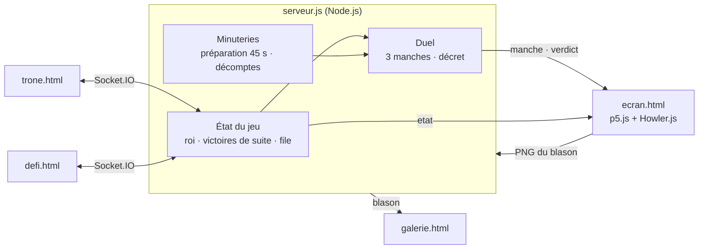
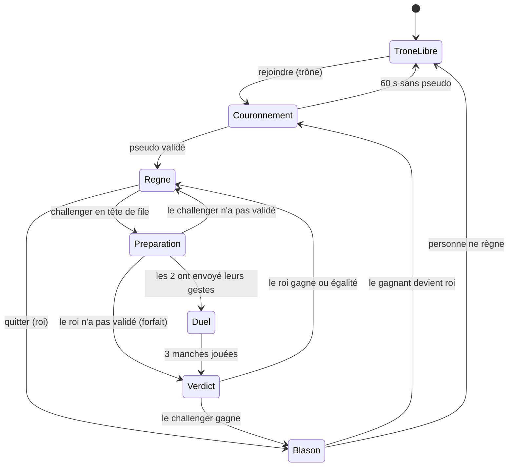

# Programmation

## Environnement de développement

| Outil évalué | Points forts | Limites pour Dethrône | Décision |
| -- | -- | -- | -- |
| **Node.js + Socket.IO** (JavaScript) | Un seul langage pour le serveur, les téléphones et les écrans ; les téléphones n'ont qu'à ouvrir une page web ; temps réel simple avec Socket.IO | Il faut gérer soi-même l'état du jeu | **Retenu** |
| **p5.js** | Dessin et animation 2D faciles dans une page web, export d'image pour le blason | Moins performant pour la 3D (pas nécessaire ici) | **Retenu** pour l'écran, la Galerie et le blason |
| **Unity** | Très bon pour l'affichage et le son | Il faudrait quand même un serveur web pour les téléphones : deux programmes à faire communiquer | Écarté pour gagner du temps |
| **TouchDesigner** | Excellent pour l'image en temps réel | Pas adapté à une logique de jeu avec file d'attente et téléphones | Écarté |

Tout le projet tient dans **un seul dossier de code JavaScript**, ce qui le rend réalisable dans le temps du cours.

## Architecture

```text
dethrone-jeu/
├── serveur.js          ← serveur Node.js : état du jeu, duel, file, Socket.IO
├── public/
│   ├── trone.html      ← page ouverte par le code QR du trône
│   ├── defi.html       ← page ouverte par le code QR du piédestal
│   ├── telephone.js    ← logique commune des pages téléphone
│   ├── ecran.html      ← écran principal (projecteur 1)
│   ├── ecran.js        ← animations p5.js, décomptes, sons, blason
│   ├── galerie.html    ← Galerie des Règnes (projecteur 2)
│   ├── sons/           ← fichiers MP3
│   └── images/         ← couronnes, icônes des gestes
└── galerie/            ← blasons sauvegardés en PNG
```



| Fichier | Rôle |
| -- | -- |
| `serveur.js` | Garde l'état du jeu, gère la file d'attente, lance les minuteries, calcule le résultat de chaque manche, compte les victoires de suite, sauvegarde les blasons |
| `trone.html` / `defi.html` | Pseudo, place dans la file, choix des 3 gestes, geste de la manche en cours, résultat, décret (roi), « Quitter le trône » (roi), blason à enregistrer |
| `ecran.html` | Affiche la scène en cours, joue les sons, dessine et envoie le blason |
| `galerie.html` | Affiche tous les blasons et ajoute les nouveaux en direct |

## Machine à états

Les états correspondent aux scènes du [scénario](/scenario/). Toutes les transitions viennent des téléphones ou des minuteries du serveur.



## Extraits de code

### Résultat d'un duel en 3 manches (serveur)

```javascript
// Parade bat Attaque, Feinte bat Parade, Attaque bat Feinte
const BAT = { Parade: "Attaque", Feinte: "Parade", Attaque: "Feinte" };

function resultatManche(gesteRoi, gesteChallenger) {
  if (gesteRoi === gesteChallenger) return "egalite";
  return BAT[gesteRoi] === gesteChallenger ? "roi" : "challenger";
}

function resultatDuel(gestesRoi, gestesChallenger) {
  const manches = gestesRoi.map((g, i) => resultatManche(g, gestesChallenger[i]));
  const pointsRoi = manches.filter(m => m === "roi").length;
  const pointsChallenger = manches.filter(m => m === "challenger").length;
  // En cas d'égalité, le roi garde son trône
  const gagnant = pointsChallenger > pointsRoi ? "challenger" : "roi";
  return { manches, pointsRoi, pointsChallenger, gagnant };
}
```

### Rejoindre le trône ou la file (serveur)

```javascript
const etat = { roi: null, victoiresDeSuite: 0, debutRegne: null, file: [], scene: "TroneLibre" };

io.on("connection", (socket) => {
  socket.on("rejoindre", ({ role, pseudo }) => {
    if (role === "trone") {
      if (etat.roi) return socket.emit("refus", "Le trône est déjà occupé : scanne le code du piédestal.");
      // Le premier téléphone qui valide prend le trône.
      // Si deux personnes arrivent en même temps, la règle affichée (le plus âgé passe en premier)
      // est appliquée par les joueurs avant de scanner.
      etat.roi = { id: socket.id, pseudo };
      etat.victoiresDeSuite = 0;
      etat.debutRegne = Date.now();
      changerScene("Couronnement");
    } else if (role === "defi") {
      if (!etat.roi) return socket.emit("refus", "Le trône est libre : va t'asseoir !");
      etat.file.push({ id: socket.id, pseudo });
      if (etat.scene === "Regne") lancerPreparation();
    }
    io.emit("etat", etatPublic());   // met à jour l'écran et tous les téléphones
  });
});
```

### Choix des 3 gestes (page du téléphone)

```javascript
const gestes = [null, null, null];
let gesteInterdit = null;   // rempli si le roi a imposé un décret

socket.on("preparer", ({ interdit }) => {
  gesteInterdit = interdit;
  document.querySelectorAll(`[data-geste="${interdit}"]`).forEach(b => b.disabled = true);
  afficher("ecran-gestes");
});

function choisir(manche, geste) {
  if (geste === gesteInterdit) return;
  gestes[manche] = geste;
  majCases();                                  // affiche l'icône dans la case de la manche
  boutonValider.disabled = gestes.includes(null);
}

boutonValider.onclick = () => {
  socket.emit("gestes", gestes);
  afficher("ecran-attente");                   // « En attente de l'adversaire »
};

socket.on("manche", ({ numero, gesteAFaire }) => {
  texteGeste.textContent = gesteAFaire;        // en très grand, pour le duel à l'épée
});
```

### Le duel rythmé (serveur)

```javascript
const attendre = (ms) => new Promise(r => setTimeout(r, ms));

async function jouerDuel(gestesRoi, gestesChallenger) {
  const challenger = etat.file[0];                                   // premier de la file
  const res = resultatDuel(gestesRoi, gestesChallenger);
  for (let i = 0; i < 3; i++) {
    io.emit("manche", { numero: i + 1, etape: "decompte" });          // « MANCHE 1 », 3… 2… 1…
    io.to(etat.roi.id).emit("manche", { numero: i + 1, gesteAFaire: gestesRoi[i] });
    io.to(challenger.id).emit("manche", { numero: i + 1, gesteAFaire: gestesChallenger[i] });
    await attendre(4000);
    io.emit("manche", { numero: i + 1, etape: "frappez" });           // les joueurs frappent
    await attendre(2000);
    io.emit("manche", { numero: i + 1, etape: "resultat",
      roi: gestesRoi[i], challenger: gestesChallenger[i], gagnant: res.manches[i] });
    await attendre(3000);
  }
  terminerDuel(res);
}
```

## Démo de faisabilité

Objectif : tester le plus d'éléments possible, sans les approfondir, pour valider les choix techniques, esthétiques et les hypothèses d'usage.

| À valider | Test à réaliser | Résultat attendu |
| -- | -- | -- |
| **Environnement de développement** | Serveur Node.js + Socket.IO avec deux pages téléphone et une page écran | Un clic sur un téléphone apparaît sur l'écran en moins d'une demi-seconde |
| **Codes QR et WiFi** | Routeur local, code QR du WiFi et code QR du trône | Un iPhone et un Android ouvrent la page du jeu en scannant les deux codes |
| **Mécanique de duel** | Choix des 3 gestes sur deux téléphones, résultat calculé par le serveur | Le bon gagnant, l'égalité qui profite au roi et le compteur de victoires de suite fonctionnent |
| **File d'attente** | 4 téléphones scannent le code du piédestal | L'ordre de passage est le même à l'écran et sur chaque téléphone |
| **Duel rythmé** | Décompte « 3, 2, 1, FRAPPEZ ! » avec deux joueurs et des épées en mousse | Les deux joueurs frappent en même temps et comprennent le résultat affiché |
| **Projection** | Deux fenêtres Chrome en mode kiosque sur deux sorties vidéo | Écran principal et Galerie s'affichent en plein écran au démarrage |
| **Blason génératif** | p5.js génère un blason à partir de fausses données de règne | Deux pseudos différents donnent deux blasons différents ; le PNG s'enregistre sur un téléphone |
| **Esthétique visuelle** | Couronne, icônes des gestes, interface du téléphone et fond intégrés dans les pages | Cohérence entre les éléments et avec l'intention esthétique |
| **Esthétique sonore** | 1 minute d'ambiance (fond) + 5 sons évènementiels (figures) avec Howler.js | Les sons sont cohérents ; le caisson de basses se ressent sur le trône |
| **Hypothèse d'usage** | Test avec 4 ou 5 personnes : scan, choix des gestes, duel à l'épée, file | Les règles sont comprises sans explication en moins d'une minute |

<iframe width="560" height="315"
  src="https://www.youtube.com/embed/ABWCq8j8qys?si=prydXi1QfvX2tqLw"
  title="YouTube video"
  frameborder="0"
  allowfullscreen>
</iframe>

