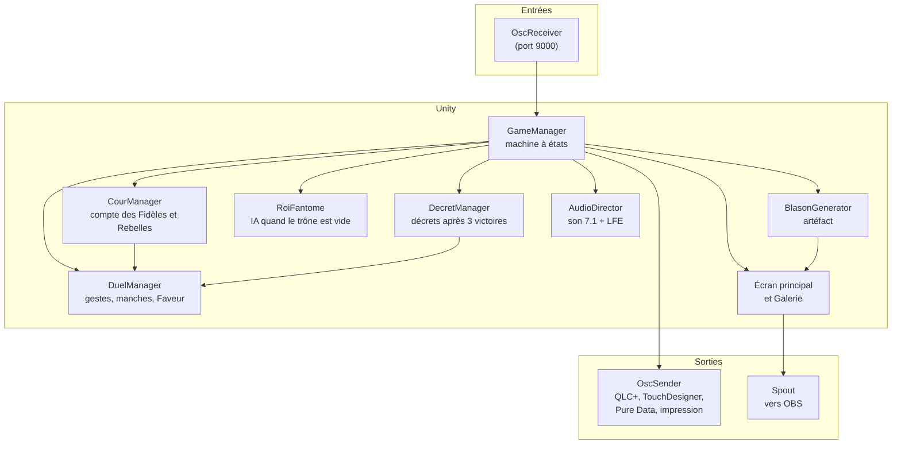
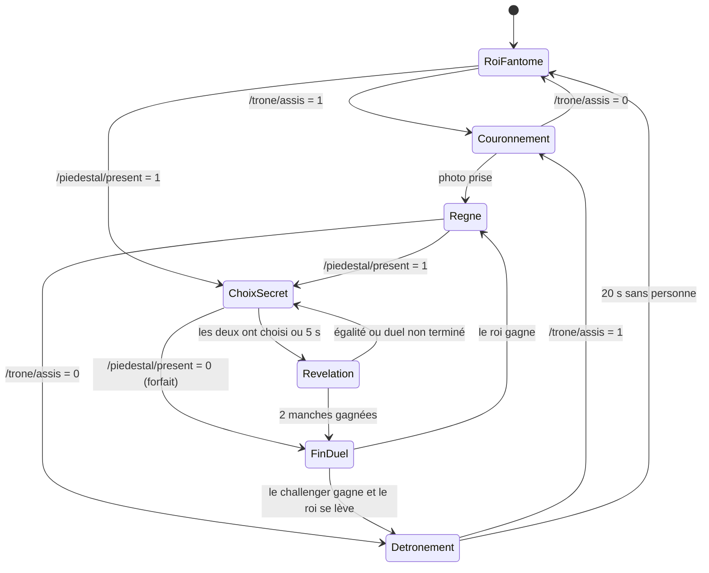

# Programmation

## Environnement de développement

| Outil évalué | Points forts | Limites pour Dethrône | Décision |
| -- | -- | -- | -- |
| **Unity** (C#) | Machine à états claire, animations 2D, particules, son 7.1, OSC et Spout disponibles | Moins pratique pour traiter l'image de la caméra | **Retenu** pour la logique du jeu, l'affichage et le son |
| **TouchDesigner** | Excellent pour la Kinect, MediaPipe et l'image en temps réel | Logique de jeu complexe difficile à organiser ; version gratuite limitée à 1280 × 1280 | **Retenu** seulement pour la caméra |
| **Godot** | Léger et gratuit | Moins d'exemples avec Spout et la Kinect | Écarté |
| **Pure Data** | Simple pour lire le port série | Pas fait pour l'affichage | **Retenu** comme pont entre les Arduino et Unity |

Chaque logiciel fait une seule tâche, et ils communiquent par **OSC** et **Spout**, comme dans l'infrastructure standard du cours.

## Architecture



| Script | Rôle |
| -- | -- |
| `GameManager` | Machine à états : passe d'une scène à l'autre selon les déclencheurs du scénario |
| `DuelManager` | Reçoit les gestes, compare, compte les manches, applique la Faveur et les décrets |
| `CourManager` | Garde le nombre de Fidèles et de Rebelles ; donne le camp majoritaire au début de chaque manche |
| `DecretManager` | Débloque un décret toutes les 3 victoires et l'applique au duel suivant |
| `RoiFantome` | Choisit les gestes de l'IA quand le trône est vide |
| `BlasonGenerator` | Assemble le blason à partir des données du règne, l'enregistre en PNG et l'ajoute à la Galerie |
| `AudioDirector` | Ambiances, sons évènementiels, volume de la foule, canal LFE pour le transducteur |
| `OscReceiver` / `OscSender` | Communication OSC (bibliothèque extOSC) |

## Machine à états

Les états correspondent aux scènes du [scénario](/scenario/).



## Extraits de code

### Résolution d'une manche (Unity, C#)

```csharp
public enum Geste { Attaque = 0, Parade = 1, Feinte = 2 }
public enum Resultat { Egalite, RoiGagne, ChallengerGagne }

public static class Duel
{
    // Parade bat Attaque, Feinte bat Parade, Attaque bat Feinte
    static bool Bat(Geste a, Geste b) =>
        (a == Geste.Parade && b == Geste.Attaque) ||
        (a == Geste.Feinte && b == Geste.Parade) ||
        (a == Geste.Attaque && b == Geste.Feinte);

    public static Resultat Comparer(Geste roi, Geste challenger)
    {
        if (roi == challenger) return Resultat.Egalite;
        return Bat(roi, challenger) ? Resultat.RoiGagne : Resultat.ChallengerGagne;
    }
}
```

### Faveur de la Cour (Unity, C#)

```csharp
// Appelé au début de chaque manche
public Camp CampMajoritaire()
{
    if (decretSilenceActif) return Camp.Aucun;          // décret « Silence »
    if (fideles > rebelles) return Camp.Fideles;        // Faveur pour le roi
    if (rebelles > fideles) return Camp.Rebelles;       // Faveur pour le challenger
    return Camp.Aucun;                                  // égalité : personne
}

// Appelé après la révélation, si un joueur perd la manche
bool FaveurAnnuleLaManche(Joueur perdant)
{
    bool protege = perdant.Camp == campDeLaManche && !perdant.FaveurUtilisee;
    if (protege) perdant.FaveurUtilisee = true;          // une fois par duel
    return protege;
}
```

### Arduino du trône (boutons + capteur de siège)

```cpp
#include <PacketSerial.h>   // encodage SLIP

SLIPPacketSerial slip;
const int BOUTONS[3] = {2, 3, 4};    // Attaque, Parade, Feinte
const int LEDS[3]    = {5, 6, 9};
const int FSR        = A0;
const int SEUIL_ASSIS = 400;

bool etatBouton[3];
bool assis = false;

void setup() {
  slip.begin(115200);
  slip.setPacketHandler(&recevoir);   // messages pour les LED
  for (int i = 0; i < 3; i++) {
    pinMode(BOUTONS[i], INPUT_PULLUP);
    pinMode(LEDS[i], OUTPUT);
  }
}

void loop() {
  for (int i = 0; i < 3; i++) {
    bool appuye = digitalRead(BOUTONS[i]) == LOW;
    if (appuye && !etatBouton[i]) envoyer('B', i);   // nouveau clic
    etatBouton[i] = appuye;
  }
  bool maintenantAssis = analogRead(FSR) > SEUIL_ASSIS;
  if (maintenantAssis != assis) {
    assis = maintenantAssis;
    envoyer('S', assis);
  }
  slip.update();
  delay(10);
}

void envoyer(char type, uint8_t valeur) {
  uint8_t msg[2] = {(uint8_t)type, valeur};
  slip.send(msg, 2);   // Pure Data décode et renvoie en OSC : /trone/bouton ou /trone/assis
}

void recevoir(const uint8_t* data, size_t taille) {
  if (taille == 2 && data[0] == 'L') {
    for (int i = 0; i < 3; i++) digitalWrite(LEDS[i], data[1]);   // LED « prêt »
  }
}
```

### ATOM PoE d'un tapis (16 dalles)

```cpp
#include <SPI.h>
#include <Ethernet.h>          // puce W5500 de l'ATOM PoE
#include <EthernetUdp.h>
#include <Wire.h>
#include <Adafruit_MCP23X17.h>
#include <OSCMessage.h>

Adafruit_MCP23X17 mcp;
EthernetUDP udp;
byte mac[] = {0xDE, 0xAD, 0xBE, 0xEF, 0x00, 0x21};
const IPAddress MOI(192, 168, 1, 21);     // 192.168.1.22 sur l'ATOM des Rebelles
const IPAddress PC(192, 168, 1, 10);
const int PORT = 9000;
const char* ADRESSE = "/cour/fideles";   // "/cour/rebelles" sur l'autre ATOM
int dernierCompte = -1;

void setup() {
  SPI.begin(22, 23, 33, 19);               // broches du W5500 de l'ATOM PoE
  Ethernet.init(19);
  Ethernet.begin(mac, MOI);
  udp.begin(8000);
  Wire.begin(26, 32);                      // port Grove → MCP23017
  mcp.begin_I2C(0x20, &Wire);
  for (int i = 0; i < 16; i++) mcp.pinMode(i, INPUT_PULLUP);
}

void loop() {
  uint16_t dalles = ~mcp.readGPIOAB();                 // 1 = dalle appuyée
  int compte = __builtin_popcount(dalles);
  if (compte != dernierCompte) {                       // envoie seulement les changements
    OSCMessage msg(ADRESSE);
    msg.add(compte);
    udp.beginPacket(PC, PORT); msg.send(udp); udp.endPacket();
    dernierCompte = compte;
  }
  delay(50);
}
```

## Le Roi Fantôme (IA)

Quand le trône est vide, le Roi Fantôme joue contre le challenger :

- Il retient les 5 derniers gestes de tous les joueurs.
- Il joue le geste qui bat le geste le plus fréquent, avec 60 % de chances ; le reste du temps, il joue au hasard.
- Il est donc battable, mais il punit les joueurs qui répètent toujours le même geste.

## Démo de faisabilité

Objectif : tester le plus d'éléments possible, sans les approfondir, pour valider les choix techniques, esthétiques et les hypothèses d'usage.

| À valider | Test à réaliser | Résultat attendu |
| -- | -- | -- |
| **Environnement de développement** | Petite scène Unity avec la machine à états et la résolution du duel au clavier | Le duel complet fonctionne, avec la révélation lente |
| **Système de capture : boutons et siège** | Arduino + 3 boutons + FSR → Pure Data → Unity | Chaque clic et le passage assis / levé arrivent dans Unity en OSC |
| **Système de capture : tapis** | 1 ATOM PoE + MCP23017 + 4 dalles → Unity | Le compte de personnes s'affiche dans Unity en temps réel |
| **Système de capture : caméra** | Kinect → TouchDesigner (MediaPipe) → Spout → Unity | Une photo du visage est prise à la demande et affichée dans Unity |
| **Projection** | Unity → Spout → OBS → 2 sorties plein écran | Les deux écrans s'affichent correctement |
| **Lumière** | Unity → OSC → QLC+ → spot DMX | Le spot change d'intensité et de couleur selon la scène |
| **Impression** | Unity → OSC → script Python → imprimante thermique | Un blason test s'imprime en moins de 5 secondes |
| **Esthétique visuelle** | Cartes, couronne, cadre et fond intégrés dans Unity | Cohérence entre les éléments et avec l'intention esthétique |
| **Esthétique sonore** | 1 minute d'ambiance (fond) + 5 sons évènementiels (figures) dans Unity | Les sons sont cohérents ; le transducteur fait vibrer le siège |
| **Hypothèse d'usage** | Test avec 4 ou 5 personnes : duel, tapis, changement de camp | Les règles sont comprises sans explication en moins d'une minute |

<iframe width="560" height="315"
  src="https://www.youtube.com/embed/ABWCq8j8qys?si=prydXi1QfvX2tqLw"
  title="YouTube video"
  frameborder="0"
  allowfullscreen>
</iframe>

