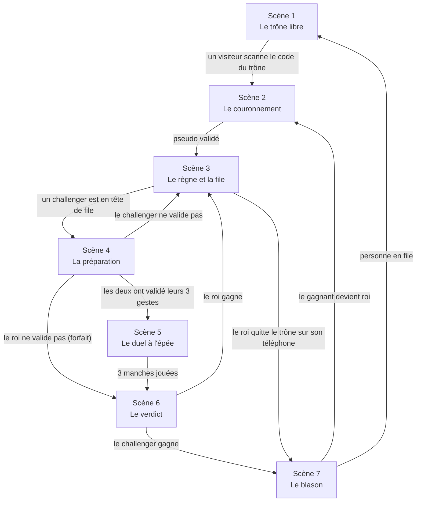
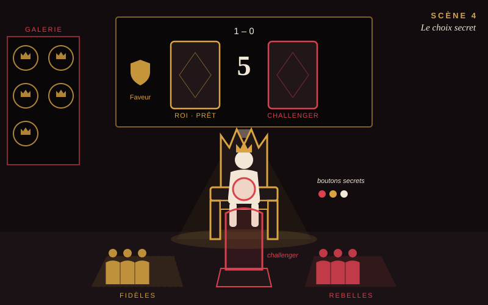
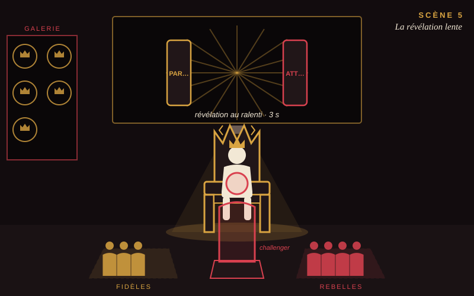

# Scénario

Cette section présente le scénario de l’interactivité du projet.

<!-- Pour chaque étape/scène : une image avec du texte descriptif et une explication de la transition -->

<!--
Éléments du scénarimage
Séquence visuelle
Chaque scène ou séquence du scénarimage doit être clairement illustrée, montrant les éléments visuels qui seront projetés ou affichés. Cette séquence visuelle peut inclure des captures d'écran, des croquis ou des rendus 3D, en fonction des besoins du projet.

Points d'interaction
Le scénarimage dans un cadre interactif inclut les moments où l'utilisateur interagit avec l'installation. Ces points d’interaction doivent être représentés graphiquement pour indiquer comment et quand l’utilisateur influencera la progression du récit ou des effets visuels et sonores.

Évolution du récit
Comme pour le scénario narratif, le scénarimage doit montrer la progression de l’histoire ou de l’expérience au fil des interactions. Il permet de visualiser comment l’installation évolue en fonction des actions de l'utilisateur, avec des embranchements possibles selon ses choix.

Retour visuel et sensoriel
Le scénarimage doit inclure des annotations ou des visuels montrant les réponses visuelles, sonores ou tactiles à chaque interaction. Cela peut inclure des changements d’éclairage, des transitions vidéo, ou des effets sonores qui réagissent aux actions de l’utilisateur.
-->

## Vue d'ensemble

L'expérience tourne en boucle : un visiteur prend le trône, des challengers le défient, et chaque roi détrôné laisse un blason dans la Galerie. Tout est déclenché par les **téléphones** des joueurs (codes QR) et par des **minuteries** : aucun capteur dans la salle.

**Règles du duel**

| Geste | Bat… | Pourquoi |
| -- | -- | -- |
| **Parade** | l'Attaque | elle bloque le coup |
| **Feinte** | la Parade | l'autre pare dans le vide |
| **Attaque** | la Feinte | elle frappe pendant que l'autre fait semblant |

- Avant le duel, chaque joueur choisit **ses 3 gestes d'avance** sur son téléphone, un par manche.
- Les **3 manches** sont toujours jouées. Une manche gagnée = 1 point ; une égalité = 0 point.
- Celui qui a le plus de points gagne le duel. **En cas d'égalité, le roi garde son trône.**
- **Décret royal** : après 3 victoires de suite, le roi peut interdire un geste (Attaque, Parade ou Feinte) à son prochain adversaire. Le geste interdit est grisé sur le téléphone du challenger.
- **Trône libre** : si deux visiteurs veulent s'asseoir en même temps, **le plus âgé a la priorité**. La règle est affichée à l'écran et sur une plaque près du trône.

## Scène 1 : Le trône libre

Personne ne règne. C'est l'état de départ de l'installation, et celui auquel elle revient quand le dernier roi est tombé et qu'aucun challenger n'attend.

**Ce que l’interacteur voit :**
- Le trône vide sous le spot.
- Sur le grand écran : « Le trône est libre. Assieds-toi et scanne le code. » et la règle « Si vous êtes deux : le plus âgé a la priorité ».
- Le code QR du trône, sur une plaque dorée fixée à l'accoudoir.
- Sur le mur de gauche, la **Galerie des Règnes** qui défile lentement.

**Ce que l’interacteur entend :**
- Une ambiance grave et réverbérante, comme une grande salle de pierre vide.
- De temps en temps, un battement de tambour lointain.

### Tableau des automatisations
| Déclenchement | Effet visuel | Effet sonore | Effet interactif |
| -- | -- | -- | -- |
| Démarrage, ou fin de la scène 7 sans challenger en file | Message « Le trône est libre » en fondu | Ambiance de salle vide | Le code QR du trône est actif |
| Aucun scan pendant 90 s | La Galerie passe aussi sur l'écran principal et défile (mode attente) | L'ambiance baisse de volume | Le prochain scan ramène l'écran normal |

### Tableau des actions
| Verbe d’action | Condition / contexte | Effet visuel | Effet sonore | Effet interactif |
| -- | -- | -- | -- | -- |
| S'assoit | Un visiteur s'assoit sur le trône | Aucun (le système ne le détecte pas) | Aucun | Il doit encore scanner le code pour devenir roi |
| Scanne | Le visiteur scanne le code QR du trône | Son téléphone ouvre la page « Prends le trône » | Coup de tambour | Le trône est réservé à ce téléphone ; passe à la **scène 2** |
| Scanne | Un visiteur scanne le code du piédestal alors que le trône est vide | Son téléphone affiche « Le trône est libre : va t'asseoir ! » | Aucun | Aucun : il faut un roi pour lancer un duel |

## Scène 2 : Le couronnement

Le visiteur vient de scanner le code du trône, ou le challenger vient de gagner son duel. Il devient roi.

**Ce que l’interacteur voit :**
- Sur son téléphone : un champ pour entrer son pseudo, puis le bouton « Prendre la couronne ».
- Sur le grand écran : « UN NOUVEAU ROI », puis son pseudo en grandes lettres dorées et une couronne vide (0 victoire).

**Ce que l’interacteur entend :**
- Une fanfare de cuivres grave et lente.
- Un coup de gong quand il valide son pseudo.

### Tableau des automatisations
| Déclenchement | Effet visuel | Effet sonore | Effet interactif |
| -- | -- | -- | -- |
| Entrée dans la scène | « UN NOUVEAU ROI » à l'écran | Fanfare | Le téléphone affiche le champ de pseudo |
| Arrivée depuis la scène 7 (un challenger a gagné) | « UN NOUVEAU ROI » puis son pseudo, déjà connu | Fanfare puis gong | Pas de pseudo à entrer : il est roi tout de suite ; passe à la **scène 3** |
| Aucun pseudo validé après 60 s | Retour au message « Le trône est libre » | Fanfare coupée | Le trône est libéré : retour à la **scène 1** |

### Tableau des actions
| Verbe d’action | Condition / contexte | Effet visuel | Effet sonore | Effet interactif |
| -- | -- | -- | -- | -- |
| Sélectionne | Le visiteur tape son pseudo et appuie sur « Prendre la couronne » | Son pseudo apparaît sous la couronne ; le chronomètre du règne démarre | Coup de gong | Il est enregistré comme roi ; passe à la **scène 3** |

## Scène 3 : Le règne et la file

Le roi est en place. Les challengers s'inscrivent dans la file d'attente, et la foule choisit son camp.

**Ce que l’interacteur voit :**
- Sur l'écran : le pseudo du roi, sa couronne (une pierre par victoire de suite) et le chronomètre de son règne.
- À droite de l'écran, la **file des challengers** : « 1. Léa · 2. Sam · 3. Noah ».
- Sur le téléphone d'un challenger : « Tu es 2e dans la file ».
- Sur le téléphone du roi : ses victoires de suite et, s'il en a 3, le bouton « Imposer un décret ».
- Au sol, le tapis doré des **Fidèles** et le tapis rouge des **Rebelles**, où la foule se place librement.

**Ce que l’interacteur entend :**
- L'ambiance de salle, plus vivante, avec des murmures de foule.

### Tableau des automatisations
| Déclenchement | Effet visuel | Effet sonore | Effet interactif |
| -- | -- | -- | -- |
| Un challenger est en tête de file | « [Pseudo] DÉFIE LE ROI » à l'écran | Coup de tambour et foule qui s'excite | Les deux téléphones passent à l'écran de préparation ; passe à la **scène 4** |
| Le roi atteint 3, 6, 9… victoires de suite | Un parchemin doré apparaît sous la couronne | Son de cor | Le bouton « Imposer un décret » s'active sur le téléphone du roi |
| Personne en file pendant 45 s | « Qui osera défier [pseudo] ? » pulse à l'écran | Tambour isolé | Aucun |

### Tableau des actions
| Verbe d’action | Condition / contexte | Effet visuel | Effet sonore | Effet interactif |
| -- | -- | -- | -- | -- |
| Scanne | Un visiteur scanne le code QR du piédestal et entre son pseudo | Son pseudo s'ajoute à la file à l'écran | Murmure de foule | Il est ajouté à la file ; son téléphone affiche sa place |
| Sélectionne | Le roi a un décret et choisit le geste à interdire | « DÉCRET : la Feinte est interdite » avec un sceau rouge | Coup de sceau | Le geste sera grisé sur le téléphone du prochain challenger |
| Quitte | Le roi appuie sur « Quitter le trône » | « LE ROI ABDIQUE » | Cloche | Son règne se termine : passe à la **scène 7** |
| Marche | Un spectateur se place sur le tapis des Fidèles ou des Rebelles | Aucun | Aucun | Aucun : les tapis servent à rassembler la foule autour de son camp |

## Scène 4 : La préparation

Le duel va commencer. Le roi et le challenger choisissent leurs 3 gestes en secret sur leur téléphone.

**Ce que l’interacteur voit :**
- Sur son téléphone : 3 cases (Manche 1, Manche 2, Manche 3) et 3 boutons (Attaque, Parade, Feinte), puis le bouton « Valider ». Un geste interdit par décret est grisé.
- Sur le grand écran : le roi à gauche, le challenger à droite, un décompte de 45 secondes, et « PRÊT » sous chaque joueur qui a validé. Les gestes ne sont jamais affichés.

**Ce que l’interacteur entend :**
- Un battement de cœur lent, qui accélère dans les 10 dernières secondes.

### Tableau des automatisations
| Déclenchement | Effet visuel | Effet sonore | Effet interactif |
| -- | -- | -- | -- |
| Entrée dans la scène | Les deux pseudos face à face ; décompte de 45 s | Battement de cœur | Les téléphones affichent le choix des gestes |
| Les deux joueurs ont validé | « PRENEZ VOS ÉPÉES » | Son de lame qu'on dégaine | Passe à la **scène 5** |
| Fin des 45 s, le challenger n'a pas validé | « [Pseudo] a fui » | Huées | Il est retiré de la file : retour à la **scène 3** |
| Fin des 45 s, le roi n'a pas validé | « LE ROI A FUI » | Huées | Le challenger gagne par forfait : passe à la **scène 6** |

### Tableau des actions
| Verbe d’action | Condition / contexte | Effet visuel | Effet sonore | Effet interactif |
| -- | -- | -- | -- | -- |
| Sélectionne | Un joueur touche un geste pour une manche | La case de la manche affiche l'icône du geste (épée, bouclier ou masque) | Petit clic | Le geste est noté ; il peut encore le changer |
| Valide | Un joueur a rempli ses 3 cases et appuie sur « Valider » | « PRÊT » sous son pseudo à l'écran ; son téléphone affiche « En attente de l'adversaire » | Son de verrou | Ses 3 gestes sont envoyés au serveur et ne peuvent plus changer |

## Scène 5 : Le duel à l'épée

Le moment central de l'expérience. Les deux joueurs prennent une épée en mousse et exécutent leurs 3 gestes en même temps, au rythme des tambours.

**Ce que l’interacteur voit :**
- Sur l'écran : « MANCHE 1 », puis « 3… 2… 1… FRAPPEZ ! » en très grandes lettres.
- Sur son téléphone (posé sur le support de l'accoudoir ou du piédestal) : le geste à faire pour la manche en cours, en grand, pour ne pas l'oublier.
- Après chaque « FRAPPEZ ! » : le résultat de la manche, par exemple « Le roi : Parade · Le challenger : Attaque → MANCHE AU ROI », et le score.

**Ce que l’interacteur entend :**
- Trois coups de tambour de plus en plus forts, puis un grand impact sur « FRAPPEZ ! ».
- Un choc d'épées quand la manche est gagnée, et la clameur de la foule.

### Tableau des automatisations
| Déclenchement | Effet visuel | Effet sonore | Effet interactif |
| -- | -- | -- | -- |
| Début de chaque manche | « MANCHE 1 », puis « 3… 2… 1… » | Trois coups de tambour | Les téléphones affichent le geste de la manche |
| Fin du décompte | « FRAPPEZ ! » plein écran | Grand impact | Les joueurs exécutent leur geste avec l'épée |
| 2 s après « FRAPPEZ ! » | Résultat de la manche et score mis à jour | Choc d'épées, ou deux lames qui glissent en cas d'égalité | Le point est attribué |
| Fin de la 3e manche | Le score final s'affiche | Coup de gong | Passe à la **scène 6** |

### Tableau des actions
| Verbe d’action | Condition / contexte | Effet visuel | Effet sonore | Effet interactif |
| -- | -- | -- | -- | -- |
| Attaque | Au signal « FRAPPEZ ! », le joueur a choisi Attaque | La foule voit le coup d'épée vers l'avant | Clameur de la foule | Aucun : le résultat vient des gestes enregistrés sur le téléphone |
| Défend | Au signal, le joueur a choisi Parade | La foule voit l'épée levée en garde | Clameur de la foule | Aucun |
| Esquive | Au signal, le joueur a choisi Feinte | La foule voit la fausse attaque et l'esquive | Clameur de la foule | Aucun |

## Scène 6 : Le verdict

Le duel est terminé. Deux issues possibles.

**Ce que l’interacteur voit :**
- **Si le roi gagne (ou en cas d'égalité)** : « LE ROI RÈGNE » ; une pierre s'ajoute à sa couronne ; le compteur de victoires de suite augmente.
- **Si le challenger gagne** : « LE ROI EST TOMBÉ », puis « [Pseudo], prends ta place sur le trône ».
- Sur les téléphones : « Victoire ! » ou « Défaite » avec le score.

**Ce que l’interacteur entend :**
- Roi gagnant : fanfare courte et clameur.
- Challenger gagnant : coup de cymbale, cloche et grande clameur.

### Tableau des automatisations
| Déclenchement | Effet visuel | Effet sonore | Effet interactif |
| -- | -- | -- | -- |
| Le roi gagne ou égalité | « LE ROI RÈGNE » ; +1 pierre sur la couronne | Fanfare courte | +1 victoire de suite ; le challenger quitte la file ; retour à la **scène 3** après 5 s |
| Le challenger gagne | « LE ROI EST TOMBÉ » ; la couronne se brise | Cymbale et cloche | Le règne du roi est terminé ; passe à la **scène 7** après 5 s |

### Tableau des actions
| Verbe d’action | Condition / contexte | Effet visuel | Effet sonore | Effet interactif |
| -- | -- | -- | -- | -- |
| Se lève | L'ancien roi quitte le trône | Aucun | Applaudissements de la foule | Aucun : l'échange de place se fait entre les joueurs |
| S'assoit | Le gagnant s'assoit sur le trône | Aucun | Aucun | Aucun : il est déjà enregistré comme nouveau roi |

## Scène 7 : Le blason

Le roi a perdu sa place (ou il a quitté le trône). Son règne devient un blason : c'est l'**artéfact** des visiteurs.

**Ce que l’interacteur voit :**
- Le blason de l'ex-roi se construit en quelques secondes à l'écran, à partir de son règne :
  - son **pseudo** est inscrit sur une banderole ;
  - le nombre de **victoires de suite** donne le nombre de pierres sur la couronne ;
  - la **durée du règne** donne la taille de la couronne ;
  - son **geste préféré** devient le symbole du blason (épée, bouclier ou masque) ;
  - les couleurs et les motifs du fond sont tirés à partir de son pseudo, donc chaque blason est unique.
- Le blason glisse vers le mur de gauche et s'ajoute à la **Galerie des Règnes**.
- Sur le téléphone de l'ex-roi : son blason et le bouton « Enregistrer l'image ».

**Ce que l’interacteur entend :**
- Un chœur grave pendant la construction du blason.

### Tableau des automatisations
| Déclenchement | Effet visuel | Effet sonore | Effet interactif |
| -- | -- | -- | -- |
| Entrée dans la scène | Construction du blason génératif (4 s) | Chœur grave | Les données du règne sont envoyées au générateur |
| Blason terminé | Le blason glisse vers la Galerie | Souffle de vent | Le blason est sauvegardé et envoyé au téléphone de l'ex-roi |
| Fin de la scène, le duel a été gagné par un challenger | « [Pseudo] PREND LE TRÔNE » | Tambour | Le gagnant devient roi : passe à la **scène 2** |
| Fin de la scène, personne ne règne et la file est vide | « Le trône est libre » | Ambiance de salle vide | Retour à la **scène 1** |

### Tableau des actions
| Verbe d’action | Condition / contexte | Effet visuel | Effet sonore | Effet interactif |
| -- | -- | -- | -- | -- |
| Sélectionne | L'ex-roi appuie sur « Enregistrer l'image » | Le blason s'enregistre dans ses photos | Aucun | Il repart avec son blason |
