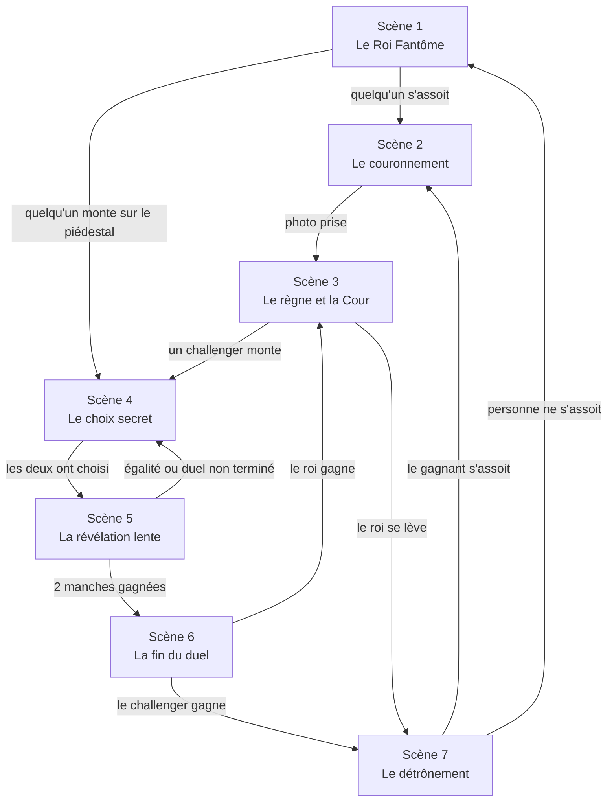
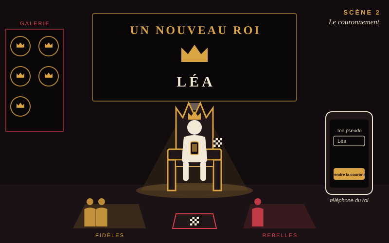
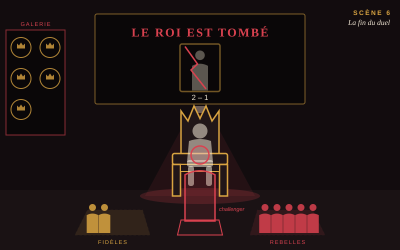

# Scénario

Cette section présente le scénario de l’interactivité du projet.

<!-- Pour chaque étape/scène : une image avec du texte descriptif et une explication de la transition -->

<!--
Éléments du scénarimage
Séquence visuelle
Chaque scène ou séquence du scénarimage doit être clairement illustrée, montrant les éléments visuels qui seront projetés ou affichés. Cette séquence visuelle peut inclure des captures d'écran, des croquis ou des rendus 3D, en fonction des besoins du projet.

Points d'interaction
Le scénarimage dans un cadre interactif inclut les moments où l'utilisateur interagit avec l'installation. Ces points d’interaction doivent être représentés graphiquement pour indiquer comment et quand l’utilisateur influencera la progression du récit ou des effets visuels et sonores.

Évolution du récit
Comme pour le scénario narratif, le scénarimage doit montrer la progression de l’histoire ou de l’expérience au fil des interactions. Il permet de visualiser comment l’installation évolue en fonction des actions de l'utilisateur, avec des embranchements possibles selon ses choix.

Retour visuel et sensoriel
Le scénarimage doit inclure des annotations ou des visuels montrant les réponses visuelles, sonores ou tactiles à chaque interaction. Cela peut inclure des changements d’éclairage, des transitions vidéo, ou des effets sonores qui réagissent aux actions de l’utilisateur.
-->

## Vue d'ensemble

L'expérience tourne en boucle : le trône est toujours occupé, par un visiteur ou par le **Roi Fantôme**. Chaque duel peut changer le roi, et chaque roi détrôné laisse un blason dans la Galerie.

**Règles du duel**

| Geste | Bat… | Pourquoi |
| -- | -- | -- |
| **Parade** | l'Attaque | elle bloque le coup |
| **Feinte** | la Parade | l'autre pare dans le vide |
| **Attaque** | la Feinte | elle frappe pendant que l'autre fait semblant |

- Le premier à **2 manches gagnantes** remporte le duel.
- Égalité : la manche est rejouée.
- **Faveur de la Cour** : au début de chaque manche, le camp le plus nombreux (Fidèles ou Rebelles) donne une Faveur à son joueur. Une fois par duel, la Faveur annule une manche perdue.
- **Décret royal** : après 3 victoires, le roi peut imposer un décret pour le prochain duel (*Interdiction* : pas de Feinte · *Désignation* : il choisit son rival · *Silence* : la Faveur est désactivée).

## Scène 1 : Le Roi Fantôme

Le trône est vide. C'est l'état de départ de l'installation, et celui auquel elle revient quand personne ne règne.

**Ce que l’interacteur voit :**
- Le trône vide, éclairé faiblement par le spot.
- Sur le grand écran, le **Roi Fantôme** : une silhouette couronnée, translucide, qui respire lentement.
- Le texte « Le trône est libre. Qui osera ? »
- Sur le mur de gauche, la **Galerie des Règnes** qui défile lentement.

**Ce que l’interacteur entend :**
- Une ambiance grave et réverbérante, comme une grande salle de pierre vide.
- De temps en temps, un battement de tambour lointain.

### Tableau des automatisations
| Déclenchement | Effet visuel | Effet sonore | Effet interactif |
| -- | -- | -- | -- |
| Démarrage de l'installation ou retour depuis la scène 7 | Le Roi Fantôme apparaît en fondu ; le spot passe à 30 % | L'ambiance de la salle vide démarre | Le roi actuel devient l'IA |
| Aucune présence détectée pendant 90 s | La Galerie des Règnes passe en grand sur l'écran principal et défile (mode attente) | L'ambiance baisse de volume | Mode attente ; toute détection ramène l'écran normal |

### Tableau des actions
| Verbe d’action | Condition / contexte | Effet visuel | Effet sonore | Effet interactif |
| -- | -- | -- | -- | -- |
| Marche | Un visiteur pose le pied sur un tapis de la Cour | Une petite flamme s'allume dans la jauge du camp choisi | Murmure de foule discret | Le visiteur est compté dans le camp |
| S'assoit | Le capteur de pression du siège est activé pendant plus de 2 s | Le Roi Fantôme se dissout en fumée | Le tambour accélère | Passe à la **scène 2** |
| Monte | Un visiteur monte sur le piédestal alors que le trône est vide | Le Roi Fantôme se tourne vers lui et lève son épée | Coup de tambour, voix grave « Tu me défies ? » | Duel contre l'IA : passe à la **scène 4** |

## Scène 2 : Le couronnement

Un visiteur vient de s'asseoir sur le trône. Il devient roi.

**Ce que l’interacteur voit :**
- Le spot s'allume à pleine puissance sur le trône.
- Sur l'écran, le texte « UN NOUVEAU ROI » et un compte à rebours 3, 2, 1.
- Sa propre photo apparaît dans un cadre doré, avec une couronne vide (0 pierre).

**Ce que l’interacteur entend :**
- Une fanfare de cuivres grave et lente.
- Un coup de gong au moment de la photo.

**Ce que l’interacteur ressent :**
- Le siège vibre au rythme de la fanfare (transducteur tactile sous le trône).

### Tableau des automatisations
| Déclenchement | Effet visuel | Effet sonore | Effet interactif |
| -- | -- | -- | -- |
| Entrée dans la scène | Spot à 100 % ; « UN NOUVEAU ROI » à l'écran ; décompte 3 s | Fanfare ; vibration du siège | La Kinect cherche un visage dans la zone du trône |
| Fin du décompte | Flash blanc, la photo se fige dans un cadre doré | Coup de gong | Photo enregistrée ; le chronomètre du règne démarre ; passe à la **scène 3** |

### Tableau des actions
| Verbe d’action | Condition / contexte | Effet visuel | Effet sonore | Effet interactif |
| -- | -- | -- | -- | -- |
| Se lève | Le siège est libéré avant la fin du décompte | « Couronnement annulé » ; le spot redescend | Fanfare coupée net | Retour à la **scène 1** |

## Scène 3 : Le règne et la Cour

Le roi est en place. La foule choisit son camp et attend qu'un challenger se présente.

**Ce que l’interacteur voit :**
- Sur l'écran : le portrait du roi, sa couronne (une pierre par victoire) et le chronomètre de son règne.
- En bas de l'écran, la **jauge de la Cour** : flammes dorées des Fidèles à gauche, flammes rouges des Rebelles à droite.
- Quand le roi a 3 victoires : une icône de parchemin, « Décret disponible ».

**Ce que l’interacteur entend :**
- L'ambiance de salle, plus vivante : murmures de foule qui grossissent avec le nombre de personnes sur les tapis.
- Un léger battement de cœur quand la jauge est serrée.

### Tableau des automatisations
| Déclenchement | Effet visuel | Effet sonore | Effet interactif |
| -- | -- | -- | -- |
| Le roi atteint 3, 6, 9… victoires | Parchemin doré qui se déroule ; les 3 décrets apparaissent au-dessus des boutons du trône | Son de cor | Les boutons du trône servent à choisir un décret |
| Aucun challenger pendant 45 s | Le texte « Qui osera ? » pulse à l'écran | Tambour isolé | Aucun |

### Tableau des actions
| Verbe d’action | Condition / contexte | Effet visuel | Effet sonore | Effet interactif |
| -- | -- | -- | -- | -- |
| Marche | Un visiteur entre sur le tapis des Fidèles ou des Rebelles | Une flamme s'ajoute dans la jauge du camp | Clameur proportionnelle au nombre de personnes | Le compte du camp augmente |
| Traverse | Un visiteur passe d'un tapis à l'autre | Une flamme change de couleur et de côté | Murmure « Ooooh » de trahison | Les comptes sont mis à jour |
| Appuie | Le roi a un décret disponible et appuie sur un bouton du trône | Le décret choisi s'affiche avec un sceau rouge | Coup de sceau | Le décret s'applique au prochain duel |
| Monte | Un visiteur monte sur le piédestal | Le portrait du challenger (silhouette) apparaît face au roi | Coup de tambour, foule qui s'excite | Passe à la **scène 4** |
| Se lève | Le roi quitte le trône sans être battu (abdication) | « LE ROI ABDIQUE » | Cloche funèbre | Passe à la **scène 7** |

## Scène 4 : Le choix secret

Le duel commence. Le roi et le challenger choisissent leur geste en secret.

**Ce que l’interacteur voit :**
- Deux cartes face cachée sur l'écran, une pour le roi, une pour le challenger.
- Le score de la manche (ex. 1 - 0) et le décompte de 5 secondes.
- La Faveur de la Cour : un bouclier doré du côté du camp majoritaire.
- La lumière de la salle baisse, seul le trône reste éclairé.

**Ce que l’interacteur entend :**
- Un battement de cœur qui accélère pendant le décompte.
- La foule qui chuchote.

### Tableau des automatisations
| Déclenchement | Effet visuel | Effet sonore | Effet interactif |
| -- | -- | -- | -- |
| Début de la manche | Les deux cartes apparaissent face cachée ; décompte 5 s ; le spot baisse à 60 % | Battement de cœur lent | La Faveur est attribuée au camp le plus nombreux ; les boutons s'activent |
| Fin des 5 s sans choix | La carte du joueur qui n'a pas choisi tremble | Son de verrou | Un geste est choisi au hasard pour lui ; passe à la **scène 5** |

### Tableau des actions
| Verbe d’action | Condition / contexte | Effet visuel | Effet sonore | Effet interactif |
| -- | -- | -- | -- | -- |
| Appuie | Le roi appuie sur Attaque, Parade ou Feinte (accoudoir du trône) | Sa carte s'entoure d'un liseré doré « PRÊT », sans montrer le geste | Son de verrou | Le choix du roi est enregistré ; il peut encore le changer |
| Appuie | Le challenger appuie sur un bouton du piédestal | Sa carte s'entoure d'un liseré rouge « PRÊT » | Son de verrou | Le choix du challenger est enregistré |
| Appuie | Les deux joueurs ont choisi | Les cartes se rapprochent du centre | Le battement de cœur s'arrête | Passe à la **scène 5** |
| Descend | Le challenger quitte le piédestal pendant le duel | « FORFAIT » | Huées de foule | Le roi gagne le duel : passe à la **scène 6** |

## Scène 5 : La révélation lente

Le moment central de l'expérience, inspiré de *Rock Paper Scissors+* : le résultat de la manche est révélé au ralenti.

**Ce que l’interacteur voit :**
- Les deux cartes se retournent très lentement, en 3 secondes.
- Le spot tremble et la lumière vacille.
- À la fin, le geste gagnant éclate en lumière ; le perdant se fissure.
- Si la Faveur est utilisée : le bouclier doré protège la carte perdante et la manche est annulée.

**Ce que l’interacteur entend :**
- Une montée de cordes et de percussions qui s'intensifie pendant 3 secondes.
- Un silence complet d'une demi-seconde, puis un impact énorme.
- La clameur de la foule (son généré + vraie foule).

**Ce que l’interacteur ressent :**
- Le trône vibre au moment de l'impact.

### Tableau des automatisations
| Déclenchement | Effet visuel | Effet sonore | Effet interactif |
| -- | -- | -- | -- |
| Entrée dans la scène | Les cartes se retournent au ralenti (3 s) ; le spot vacille | Montée sonore | Les boutons sont désactivés |
| Fin de la révélation, une manche est gagnée | Le geste gagnant éclate en or, le perdant se fissure ; le score change | Silence 0,5 s puis impact ; vibration du trône | Le point est attribué |
| Le joueur qui perd a la Faveur | Un bouclier doré se place devant sa carte | Choc métallique | La manche est annulée ; la Faveur est consommée |
| Égalité | Les deux cartes s'entrechoquent et reculent | Choc d'épées | La manche est rejouée : retour à la **scène 4** |
| Personne n'a encore 2 manches | « Manche suivante » | Tambour | Retour à la **scène 4** |
| Un joueur atteint 2 manches | Les cartes disparaissent | Coup de gong | Passe à la **scène 6** |

### Tableau des actions
| Verbe d’action | Condition / contexte | Effet visuel | Effet sonore | Effet interactif |
| -- | -- | -- | -- | -- |
| Traverse | Un visiteur change de camp pendant la révélation | Sa flamme change de côté dans la jauge | Murmure | Le changement compte seulement pour la manche suivante |

## Scène 6 : La fin du duel

Le duel est terminé. Deux issues possibles.

**Ce que l’interacteur voit :**
- **Si le roi gagne** : « LE ROI RÈGNE » ; une nouvelle pierre s'ajoute à sa couronne ; le spot reste sur lui.
- **Si le challenger gagne** : « LE ROI EST TOMBÉ » ; le portrait du roi se fissure ; le spot clignote en rouge.

**Ce que l’interacteur entend :**
- Roi gagnant : fanfare courte et clameur des Fidèles.
- Challenger gagnant : coup de cymbale, cloche et grande clameur.

### Tableau des automatisations
| Déclenchement | Effet visuel | Effet sonore | Effet interactif |
| -- | -- | -- | -- |
| Le roi gagne | « LE ROI RÈGNE » ; +1 pierre sur la couronne | Fanfare courte ; vibration du siège | Le compteur de victoires du roi augmente |
| Le challenger gagne | « LE ROI EST TOMBÉ » ; portrait fissuré ; spot rouge clignotant | Cymbale et cloche | Le système attend que le roi se lève |
| Le roi reste assis 10 s après sa défaite | « LÈVE-TOI » en grand | Huées de foule | Le texte pulse jusqu'à ce que le siège soit libéré |

### Tableau des actions
| Verbe d’action | Condition / contexte | Effet visuel | Effet sonore | Effet interactif |
| -- | -- | -- | -- | -- |
| Descend | Le challenger perdant quitte le piédestal | Sa silhouette disparaît | Murmure | Retour à la **scène 3** |
| Se lève | Le roi battu quitte le trône | Le spot redevient doré et attend | Silence | Passe à la **scène 7** |

## Scène 7 : Le détrônement et le blason

Le roi a perdu sa place. Son règne devient un blason : c'est l'**artéfact** des visiteurs.

**Ce que l’interacteur voit :**
- Le blason de l'ex-roi se construit en quelques secondes à l'écran, à partir de son règne :
  - sa **photo** devient le portrait stylisé au centre ;
  - la **durée du règne** détermine la taille de la couronne ;
  - le **nombre de victoires** détermine le nombre de pierres ;
  - son **geste préféré** devient le symbole du blason (épée, bouclier ou masque).
- Le blason glisse de l'écran principal vers le mur de gauche et s'ajoute à la **Galerie des Règnes**.
- Le ticket imprimé sort à la sortie de la salle.
- Le texte « Le trône vous attend » pour le gagnant.

**Ce que l’interacteur entend :**
- Un chœur grave pendant la construction du blason.
- Le bruit de l'imprimante.

### Tableau des automatisations
| Déclenchement | Effet visuel | Effet sonore | Effet interactif |
| -- | -- | -- | -- |
| Entrée dans la scène | Construction du blason génératif (4 s) | Chœur grave | Les données du règne sont envoyées au générateur |
| Blason terminé | Le blason glisse vers la Galerie (projecteur 2) | Souffle de vent | Le blason est sauvegardé ; le ticket est imprimé |
| Personne ne s'assoit pendant 20 s | Le Roi Fantôme réapparaît | Ambiance de salle vide | Retour à la **scène 1** |

### Tableau des actions
| Verbe d’action | Condition / contexte | Effet visuel | Effet sonore | Effet interactif |
| -- | -- | -- | -- | -- |
| S'assoit | Le gagnant (ou un autre visiteur) s'assoit sur le trône | Le spot remonte à 100 % | Le tambour reprend | Passe à la **scène 2** |
| Ramasse | L'ex-roi prend son ticket à l'imprimante | Aucun | Aucun | Aucun : le ticket est le souvenir qu'il garde |
