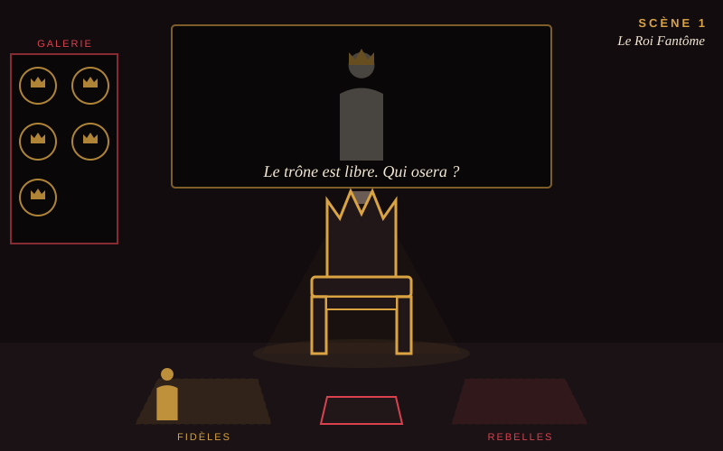
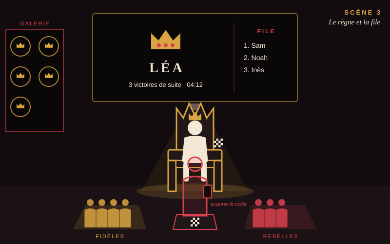
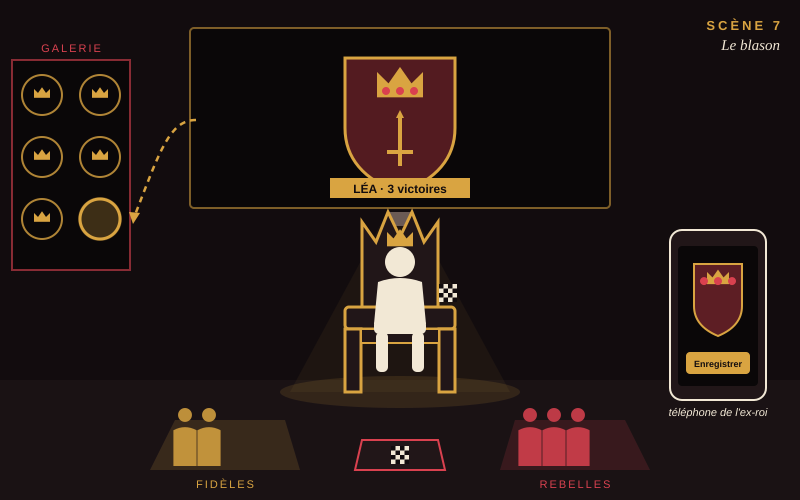

# Scénario

Cette section présente le scénario de l’interactivité du projet.

<!-- Pour chaque étape/scène : une image avec du texte descriptif et une explication de la transition -->

<!--
Éléments du scénarimage
Séquence visuelle
Chaque scène ou séquence du scénarimage doit être clairement illustrée, montrant les éléments visuels qui seront projetés ou affichés. Cette séquence visuelle peut inclure des captures d'écran, des croquis ou des rendus 3D, en fonction des besoins du projet.

Points d'interaction
Le scénarimage dans un cadre interactif inclut les moments où l'utilisateur interagit avec l'installation. Ces points d’interaction doivent être représentés graphiquement pour indiquer comment et quand l’utilisateur influencera la progression du récit ou des effets visuels et sonores.

Évolution du récit
Comme pour le scénario narratif, le scénarimage doit montrer la progression de l’histoire ou de l’expérience au fil des interactions. Il permet de visualiser comment l’installation évolue en fonction des actions de l'utilisateur, avec des embranchements possibles selon ses choix.

Retour visuel et sensoriel
Le scénarimage doit inclure des annotations ou des visuels montrant les réponses visuelles, sonores ou tactiles à chaque interaction. Cela peut inclure des changements d’éclairage, des transitions vidéo, ou des effets sonores qui réagissent aux actions de l’utilisateur.
-->

## Scène 1 : Le trône libre

| Verbe d’action | Condition de déclenchement | Effet visuel | Effet sonore | Effet interactif |
|---------------|----------------------------|--------------|--------------|------------------|
| **Observer** | Personne n'est sur le trône | « Le trône est libre » à l'écran | Ambiance de salle vide | Le visiteur comprend qu'il peut prendre le trône |
| **S'asseoir** | Un visiteur s'assoit sur le trône | Aucun changement | Aucun | Il doit scanner le code pour devenir roi |
| **Scanner** | Le visiteur scanne le code QR du trône | La page du jeu s'ouvre sur son téléphone | Coup de tambour | Le trône lui est réservé : passe à la scène 2 |

---

## Scène 2 : Le couronnement

| Verbe d’action | Condition de déclenchement | Effet visuel | Effet sonore | Effet interactif |
|---------------|----------------------------|--------------|--------------|------------------|
| **Écrire** | Le visiteur entre son pseudo sur son téléphone | Champ « Ton pseudo » | Aucun | Il choisit le nom affiché à l'écran |
| **Valider** | Il appuie sur « Prendre la couronne » | « UN NOUVEAU ROI » et son pseudo sous la couronne | Fanfare et gong | Il devient roi : passe à la scène 3 |

---

## Scène 3 : Le règne et la file

| Verbe d’action | Condition de déclenchement | Effet visuel | Effet sonore | Effet interactif |
|---------------|----------------------------|--------------|--------------|------------------|
| **Régner** | Le roi est sur le trône | Pseudo, couronne et victoires de suite à l'écran | Ambiance et murmures de foule | Le roi attend un challenger |
| **Scanner** | Un visiteur scanne le code QR du piédestal | Son pseudo s'ajoute à la file à l'écran | Murmure de foule | Il entre dans la file d'attente |
| **Se placer** | Les spectateurs vont sur un tapis | Aucun | Aucun | Fidèles ou Rebelles : aucun effet sur le jeu |
| **Imposer** | Le roi a 3 victoires de suite | Parchemin « Décret » à l'écran | Cor et sceau | Il interdit un geste à son prochain adversaire |
| **Quitter** | Le roi appuie sur « Quitter le trône » | « LE ROI ABDIQUE » | Cloche | Son règne se termine : passe à la scène 7 |

---

## Scène 4 : La préparation

| Verbe d’action | Condition de déclenchement | Effet visuel | Effet sonore | Effet interactif |
|---------------|----------------------------|--------------|--------------|------------------|
| **Choisir** | Le challenger est en tête de file | Les deux pseudos face à face et un décompte de 45 s | Battement de cœur | Chacun choisit ses 3 gestes en secret sur son téléphone |
| **Valider** | Un joueur a rempli ses 3 manches | « PRÊT » sous son pseudo | Son de verrou | Ses gestes sont envoyés et ne changent plus |
| **Fuir** | Un joueur ne valide pas avant 45 s | « [Pseudo] a fui » | Huées | Il perd par forfait |
| **Dégainer** | Les deux joueurs ont validé | « PRENEZ VOS ÉPÉES » | Lame qu'on dégaine | Passe à la scène 5 |

---

## Scène 5 : Le duel à l'épée

| Verbe d’action | Condition de déclenchement | Effet visuel | Effet sonore | Effet interactif |
|---------------|----------------------------|--------------|--------------|------------------|
| **Attendre** | Début de chaque manche | « MANCHE 1 », puis « 3… 2… 1… » | Trois coups de tambour | Le téléphone affiche le geste à faire |
| **Frapper** | « FRAPPEZ ! » apparaît | « FRAPPEZ ! » en grand | Grand impact | Les deux joueurs font leur geste à l'épée en même temps |
| **Observer** | 2 secondes après le coup | Les deux gestes et le gagnant de la manche | Choc d'épées et clameur | Le point est ajouté au score |
| **Recommencer** | Il reste des manches | « MANCHE 2 » | Tambour | Après la 3e manche : passe à la scène 6 |

---

## Scène 6 : Le verdict

| Verbe d’action | Condition de déclenchement | Effet visuel | Effet sonore | Effet interactif |
|---------------|----------------------------|--------------|--------------|------------------|
| **Gagner** | Le roi gagne ou il y a égalité | « LE ROI RÈGNE », une pierre de plus sur la couronne | Fanfare | +1 victoire de suite : retour à la scène 3 |
| **Tomber** | Le challenger gagne | « LE ROI EST TOMBÉ », la couronne se brise | Cymbale et cloche | Le règne se termine : passe à la scène 7 |
| **Échanger** | Après la défaite du roi | « Prends ta place sur le trône » | Applaudissements | L'ancien roi se lève, le gagnant s'assoit |

---

## Scène 7 : Le blason

| Verbe d’action | Condition de déclenchement | Effet visuel | Effet sonore | Effet interactif |
|---------------|----------------------------|--------------|--------------|------------------|
| **Observer** | Le règne vient de se terminer | Le blason de l'ex-roi se construit, puis rejoint la Galerie | Chœur grave | Le blason est créé à partir du pseudo, des victoires et du geste préféré |
| **Enregistrer** | L'ex-roi reçoit son blason sur son téléphone | Blason et bouton « Enregistrer » | Aucun | Il garde son blason en souvenir |
| **Recommencer** | Le gagnant devient roi, ou personne n'attend | « [Pseudo] PREND LE TRÔNE » ou « Le trône est libre » | Tambour ou ambiance vide | Passe à la scène 2 ou à la scène 1 |
