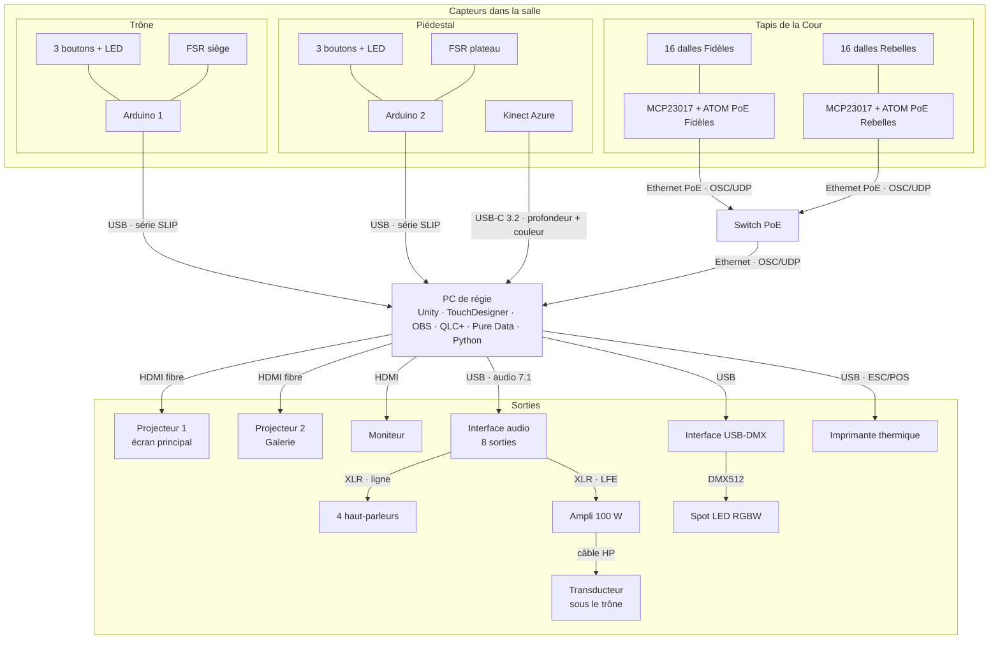
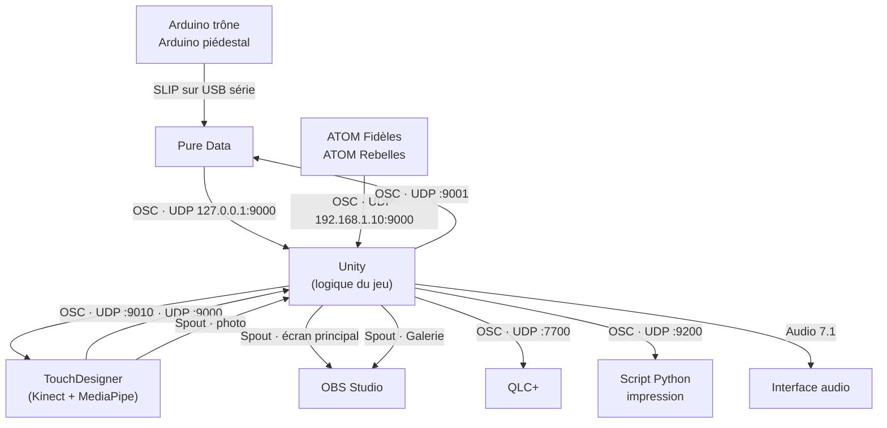

# Technique

## Équipements

Salle de référence : 8 m × 7 m, plafond de 4,5 m, salle sombre (voir la section Plans plus bas).

### Projection

| Qté | Équipement | Justification |
| --: | -- | -- |
| 2 | Projecteur laser 5 000 lumens, WUXGA (1920 × 1200), objectif zoom 1,0–1,6 | Un pour l'**écran principal** (derrière le trône), un pour la **Galerie des Règnes** (mur de gauche). 5 000 lm suffisent pour une image de 4 m dans une salle sombre. Le laser évite de changer de lampe pendant l'exposition. Le zoom permet de faire une image de 4 m de large à 4 m (P1) et à 5 m (P2). |
| 2 | Support de plafond | Les projecteurs sont suspendus à 4,1 m pour que le faisceau passe au-dessus du roi et du challenger (voir la coupe). |
| 2 | Toile de projection tendue 4 × 2,25 m | Surface uniforme pour l'écran principal et la Galerie (format 16:9). |

### Ordinateur

| Qté | Équipement | Justification |
| --: | -- | -- |
| 1 | PC de régie : Core i7, carte graphique RTX 4070, 32 Go de RAM, 3 sorties vidéo | Fait tourner **Unity**, **TouchDesigner** (Kinect), **OBS**, **QLC+** et **Pure Data** en même temps. Il faut 2 sorties pour les projecteurs et 1 pour le moniteur de contrôle. La RTX est requise par le SDK de la Kinect Azure. |
| 1 | Moniteur de contrôle 24 po | Surveiller l'installation et les logiciels depuis la régie. |

### Capteurs et contrôleurs

| Qté | Équipement | Justification |
| --: | -- | -- |
| 1 | Kinect Azure (ou Orbbec Femto Bolt) | Montée sur la console du piédestal, tournée vers le trône (2,3 m). Elle prend la **photo du roi** au couronnement et vérifie qu'un visage est bien dans le cadre. Portée de 0,5 à 3,9 m. |
| 2 | Arduino Uno R4 | Un dans le **trône**, un dans le **piédestal**. Chacun lit 3 boutons et 1 capteur de force, et allume les LED des boutons. |
| 6 | Bouton d'arcade lumineux 60 mm | 3 dans l'accoudoir du trône, 3 sur la console du piédestal : **Attaque**, **Parade**, **Feinte**. La LED intégrée confirme le choix (« prêt ») sans le révéler à la foule. |
| 2 | Capteur de force FSR 38 mm | Un sous le coussin du trône (**le roi est assis**), un sous le plateau du piédestal (**un challenger est présent**). |
| 32 | Dalle de pression 50 × 50 cm (interrupteur de sol) | 16 dalles par tapis de 2 × 2 m. Chaque dalle activée compte comme une personne : on peut **compter** les Fidèles et les Rebelles, et pas seulement détecter une présence. |
| 2 | M5Stack ATOM PoE | Un par tapis. Il lit les 16 dalles et envoie le compte en **OSC** par Ethernet. Alimenté par le câble réseau (PoE) : aucun bloc d'alimentation au sol. |
| 2 | Module d'entrées MCP23017 | L'ATOM n'a que quelques broches : le MCP23017 ajoute 16 entrées (une par dalle) par I2C. |

### Réseau

| Qté | Équipement | Justification |
| --: | -- | -- |
| 1 | Switch Gigabit PoE 8 ports | Relie le PC aux deux ATOM PoE et les alimente. |
| 0 | Routeur | Pas nécessaire : réseau local fermé avec adresses IP fixes (voir le plan d’adressage plus bas). Aucun accès Internet requis pendant l'exposition. |

### Éclairage

| Qté | Équipement | Justification |
| --: | -- | -- |
| 1 | Projecteur de découpe LED RGBW, DMX | Le **spot** au-dessus du trône : il isole le roi (blanc chaud), tremble pendant la révélation et passe au rouge quand le roi tombe. La découpe évite d'éclairer les écrans. |
| 1 | Interface USB-DMX (Enttec DMX USB Pro) | Relie QLC+ au spot. Compatible directement avec QLC+. |

### Son

| Qté | Équipement | Justification |
| --: | -- | -- |
| 1 | Interface audio USB 8 sorties (ex. Behringer UMC1820) | Unity sort en 7.1 : 4 canaux pour les haut-parleurs et le canal des basses (LFE) pour le transducteur. |
| 4 | Haut-parleur actif 8 po | Un dans chaque coin, à 2,2 m : son enveloppant pour l'ambiance de grande salle et la clameur de foule. |
| 4 | Pied ou support mural | Fixer les haut-parleurs à 2,2 m, hors de portée du public. |
| 1 | Transducteur tactile (bass shaker) | Vissé sous le siège du trône : le roi **sent** la fanfare et l'impact de la révélation. C'est le « caisson de basses » du trône. |
| 1 | Amplificateur 100 W | Alimente le transducteur. |
| 0 | Microphone | Pas nécessaire : la clameur de la vraie foule s'ajoute naturellement au son de l'installation. |

### Impression

| Qté | Équipement | Justification |
| --: | -- | -- |
| 1 | Imprimante thermique de reçus 80 mm, USB | Imprime le **blason** de l'ex-roi sur un ticket qu'il emporte. Thermique : pas d'encre, rapide et silencieuse. Placée près de la sortie, reliée à la régie (2 m). |
| 1 | Boîte de papier thermique 80 mm | Environ 50 rouleaux. |

### Décor

| Qté | Équipement | Justification |
| --: | -- | -- |
| 1 | Trône (MDF, peinture dorée, rembourrage) | L'**objet central** de l'installation. Il cache l'Arduino, le FSR, les boutons et le transducteur. |
| 1 | Piédestal 60 × 60 cm, 20 cm de haut, avec console à 1,1 m | Le challenger monte dessus. La console porte les 3 boutons et la Kinect. |

### Câbles

| Qté | Câble | De → vers |
| --: | -- | -- |
| 2 | HDMI actif fibre 15 m | PC → projecteurs 1 et 2 |
| 5 | XLR 15 m | Interface audio → 4 haut-parleurs et amplificateur du transducteur |
| 3 | Ethernet Cat6 | Switch → ATOM Fidèles, ATOM Rebelles (10 m) ; switch → PC (2 m) |
| 2 | Rallonge USB active 10 m | PC → Arduino du trône et du piédestal |
| 1 | Rallonge USB-C 3.2 active 10 m | PC → Kinect |
| 1 | Câble DMX 3 broches 15 m | Interface USB-DMX → spot |
| 1 | Câble USB 5 m | PC → imprimante |
| 6 | Rallonges et barres d'alimentation | Projecteurs, haut-parleurs, régie, spot |
| 1 | Ruban de sol et passe-câbles | Tous les câbles au sol sont couverts pour la sécurité du public |

## Logiciels

| Rôle | Logiciel | Utilisation dans Dethrône |
| -- | -- | -- |
| Environnement de programmation principal | **Unity** (C#) | Logique du jeu (scènes, duel, Faveur, décrets, Roi Fantôme), affichage de l'écran principal et de la Galerie, génération des blasons, son 7.1 |
| Programmation des microcontrôleurs | **Arduino IDE** | Lecture des boutons et des FSR, LED des boutons ; envoi des messages en SLIP |
| Programmation des ATOM PoE | **Arduino IDE** + bibliothèque M5Atom | Lecture des 16 dalles par tapis, envoi en OSC |
| Traitement de capteurs (série) | **Pure Data** | Pont entre les Arduino (USB série, SLIP) et Unity (OSC) |
| Traitement de la caméra | **TouchDesigner** + **MediaPipe** | Image de la Kinect, détection du visage, photo du roi ; image envoyée à Unity par Spout |
| Partage vidéo entre logiciels | **Spout** | TouchDesigner → Unity (photo), Unity → OBS (rendu des deux écrans) |
| Logiciel de projection | **OBS Studio** | Reçoit les 2 rendus de Unity par Spout et les envoie en plein écran sur chaque projecteur ; ajustement de la géométrie |
| Gestion d'éclairage | **QLC+** | Reçoit les commandes OSC de Unity et pilote le spot en DMX |
| Gestion du son | **Unity Audio** (sortie 7.1) | Ambiances, sons évènementiels, spatialisation sur 4 haut-parleurs, canal LFE vers le transducteur |
| Impression | **Python** + **python-escpos** | Petit serveur OSC qui reçoit le chemin du blason et l'imprime |
| Production sonore | **Reaper** | Création des ambiances et des sons évènementiels |
| Production visuelle | **Illustrator**, **Photoshop**, **TouchDesigner** | Cartes, couronnes, interface, éléments du blason |

## Synoptique

### Câblage et signaux

### Communication entre les logiciels

### Protocoles et signaux

| Liaison | Type de signal | Protocole | Détail |
| -- | -- | -- | -- |
| Arduino → Pure Data | Données série sur USB | **SLIP** | Chaque message (bouton, FSR) est encodé en SLIP pour être découpé proprement |
| Pure Data → Unity | Réseau local (même PC) | **OSC sur UDP** | Pure Data décode le SLIP et retransmet en OSC |
| Unity → Pure Data → Arduino | Données série sur USB | **SLIP** | Allumer les LED des boutons (« prêt ») |
| ATOM PoE → Unity | Ethernet | **OSC sur UDP** | Nombre de personnes sur chaque tapis, envoyé à chaque changement |
| TouchDesigner ↔ Unity | Réseau local + mémoire GPU | **OSC sur UDP** + **Spout** | Demande de photo, visage détecté ; image partagée par Spout |
| Unity → OBS | Mémoire GPU | **Spout** | Deux textures : écran principal et Galerie |
| OBS → projecteurs | Vidéo | **HDMI** | 1920 × 1200, 60 Hz |
| Unity → QLC+ | Réseau local | **OSC sur UDP** | Intensité, couleur et tremblement du spot |
| QLC+ → spot | Lumière | **DMX512** | Univers 1, adresse 1, mode 8 canaux |
| Unity → imprimante | Réseau local puis USB | **OSC sur UDP** puis **ESC/POS** | Le script Python reçoit le chemin du blason et l'imprime |
| Unity → haut-parleurs | Audio | **USB audio**, puis analogique **XLR** | 7.1 : canaux 1 à 4 pour les haut-parleurs, canal LFE pour le transducteur |

### Messages OSC

| Adresse | Valeurs | Source → destination |
| -- | -- | -- |
| `/trone/assis` | `0` ou `1` | Arduino 1 → Unity |
| `/trone/bouton` | `0` Attaque, `1` Parade, `2` Feinte | Arduino 1 → Unity |
| `/piedestal/present` | `0` ou `1` | Arduino 2 → Unity |
| `/piedestal/bouton` | `0`, `1` ou `2` | Arduino 2 → Unity |
| `/cour/fideles` | nombre de dalles actives (0 à 16) | ATOM Fidèles → Unity |
| `/cour/rebelles` | nombre de dalles actives (0 à 16) | ATOM Rebelles → Unity |
| `/kinect/visage` | `0` ou `1` | TouchDesigner → Unity |
| `/kinect/photo` | demande de photo / chemin du fichier | Unity ↔ TouchDesigner |
| `/led/trone`, `/led/piedestal` | `0` éteint, `1` prêt | Unity → Pure Data → Arduino |
| `/lumiere/spot` | intensité, R, V, B, B, tremblement | Unity → QLC+ |
| `/imprimante/blason` | chemin de l'image PNG | Unity → script Python |

### Plan d'adressage

| Appareil | Adresse IP | Port d'écoute |
| -- | -- | -- |
| PC de régie | `192.168.1.10` | Unity `9000` · Pure Data `9001` · TouchDesigner `9010` · QLC+ `7700` · impression `9200` |
| ATOM PoE Fidèles | `192.168.1.21` | — (envoie seulement) |
| ATOM PoE Rebelles | `192.168.1.22` | — (envoie seulement) |

Masque `255.255.255.0`, sans passerelle : le réseau est isolé.

## Plans

<!--
Plans d'implantation 2D et 3D
-->

Les plans sont **à l'échelle** (1 m = 70 px, grille de 1 m). La salle de référence mesure 8 m × 7 m avec un plafond de 4,5 m.

### Plan d'implantation (vue de dessus)

### Coupe (vue de côté)

### Choix d'implantation

- **Le trône au fond, au centre**, face à l'entrée : c'est la première chose qu'on voit en entrant. L'écran principal est juste au-dessus (de 1,9 m à 4,15 m), pour que le roi et son image soient vus ensemble.
- **Le piédestal à 1,7 m du trône**, face à lui : le duel se joue en face-à-face, et la Kinect sur sa console voit le trône à 2,3 m (dans sa portée de 0,5 à 3,9 m).
- **Les projecteurs au plafond à 4,1 m** : le faisceau du projecteur 1 passe à environ 3,6 m au-dessus du piédestal, donc personne ne fait d'ombre sur l'écran.
- **Les tapis de chaque côté du piédestal** (2 × 2 m chacun), à 1 m des murs : la foule entoure le duel, et le tapis des Fidèles reste hors de l'ombre du projecteur 2.
- **La file des challengers dans l'allée centrale**, derrière le piédestal.
- **Un haut-parleur dans chaque coin**, à 2,2 m de haut, tourné vers le centre.
- **La régie dans un meuble fermé sur le mur de droite**, hors du parcours des visiteurs. **L'imprimante près de la sortie** : l'ex-roi récupère son ticket en partant.
- **Parcours** : on entre en bas à droite, on remonte l'allée centrale vers le trône, on se place sur un tapis ou dans la file, et on ressort par la même porte en passant devant l'imprimante.

## Budget

Estimation en dollars canadiens, taxes non incluses. Les prix sont indicatifs et à mettre à jour avec des soumissions.

### Matériel

| Catégorie | Élément | Qté | Prix unitaire | Total |
| -- | -- | --: | --: | --: |
| Projection | Projecteur laser 5 000 lumens, WUXGA, objectif zoom 1,0–1,6 | 2 | 2 800 $ | 5 600 $ |
| Projection | Support de plafond pour projecteur | 2 | 90 $ | 180 $ |
| Projection | Toile de projection tendue 4 × 2,25 m | 2 | 350 $ | 700 $ |
| Ordinateur | PC de régie (Core i7, RTX 4070, 32 Go RAM, 3 sorties vidéo) | 1 | 2 800 $ | 2 800 $ |
| Ordinateur | Moniteur de contrôle 24 po | 1 | 200 $ | 200 $ |
| Capteurs | Kinect Azure (ou Orbbec Femto Bolt) | 1 | 650 $ | 650 $ |
| Contrôleurs | Arduino Uno R4 | 2 | 40 $ | 80 $ |
| Capteurs | Bouton d'arcade lumineux 60 mm | 6 | 8 $ | 48 $ |
| Capteurs | Capteur de force FSR 38 mm (siège, piédestal) | 2 | 25 $ | 50 $ |
| Capteurs | Dalle de pression 50 × 50 cm (interrupteur de sol) | 32 | 20 $ | 640 $ |
| Contrôleurs | M5Stack ATOM PoE | 2 | 55 $ | 110 $ |
| Contrôleurs | Module d'entrées MCP23017 (16 entrées) | 2 | 8 $ | 16 $ |
| Réseau | Switch Gigabit PoE 8 ports | 1 | 140 $ | 140 $ |
| Éclairage | Projecteur de découpe LED RGBW, DMX | 1 | 450 $ | 450 $ |
| Éclairage | Interface USB-DMX (Enttec DMX USB Pro) | 1 | 260 $ | 260 $ |
| Son | Interface audio USB 8 sorties (ex. Behringer UMC1820) | 1 | 400 $ | 400 $ |
| Son | Haut-parleur actif 8 po | 4 | 350 $ | 1 400 $ |
| Son | Pied ou support mural de haut-parleur | 4 | 40 $ | 160 $ |
| Son | Transducteur tactile (bass shaker) sous le siège | 1 | 120 $ | 120 $ |
| Son | Amplificateur 100 W pour le transducteur | 1 | 130 $ | 130 $ |
| Impression | Imprimante thermique de reçus 80 mm USB | 1 | 350 $ | 350 $ |
| Impression | Papier thermique 80 mm (boîte de 50 rouleaux) | 1 | 60 $ | 60 $ |
| Décor | Trône (fabrication MDF, peinture, rembourrage) | 1 | 450 $ | 450 $ |
| Décor | Piédestal avec console (fabrication) | 1 | 150 $ | 150 $ |
| Câbles | HDMI actif fibre 15 m | 2 | 70 $ | 140 $ |
| Câbles | XLR 15 m | 5 | 30 $ | 150 $ |
| Câbles | Ethernet Cat6 (2 × 10 m, 1 × 2 m) | 3 | 15 $ | 45 $ |
| Câbles | Rallonge USB active 10 m (Arduino) | 2 | 35 $ | 70 $ |
| Câbles | Rallonge USB-C 3.2 active 10 m (Kinect) | 1 | 90 $ | 90 $ |
| Câbles | Câble DMX 3 broches 15 m | 1 | 30 $ | 30 $ |
| Câbles | Câble USB imprimante 5 m | 1 | 12 $ | 12 $ |
| Câbles | Rallonges électriques et barres d'alimentation | 6 | 25 $ | 150 $ |
| Câbles | Ruban de sol et passe-câbles | 1 | 80 $ | 80 $ |
| | **Sous-total matériel** | | | **15 911 $** |

### Logiciels

| Logiciel | Coût |
| -- | --: |
| Unity Personal | 0 $ |
| TouchDesigner Non-Commercial | 0 $ |
| OBS Studio | 0 $ |
| QLC+ | 0 $ |
| Pure Data | 0 $ |
| Arduino IDE | 0 $ |
| Python + python-escpos | 0 $ |
| Reaper (licence réduite) | 85 $ |
| Suite Adobe (licence du collège) | 0 $ |
| **Sous-total logiciels** | **85 $** |

### Développement

| Tâche | Heures | Taux horaire | Total |
| -- | --: | --: | --: |
| Programmation (Unity, Arduino, intégration) | 120 h | 25 $ | 3 000 $ |
| Production visuelle et sonore | 40 h | 25 $ | 1 000 $ |
| Fabrication et montage | 30 h | 25 $ | 750 $ |
| **Sous-total développement** | | | **4 750 $** |

### Maintenance (pour un mois d'exposition)

| Élément | Qté | Prix unitaire | Total |
| -- | --: | --: | --: |
| Boutons d'arcade de rechange | 6 | 8 $ | 48 $ |
| Papier thermique supplémentaire (boîte) | 1 | 60 $ | 60 $ |
| Remplacement de dalles de pression | 4 | 20 $ | 80 $ |
| **Sous-total maintenance** | | | **188 $** |

### Total

| Poste | Montant |
| -- | --: |
| Matériel | 15 911 $ |
| Logiciels | 85 $ |
| Développement | 4 750 $ |
| Maintenance | 188 $ |
| Imprévus (10 %) | 2 093 $ |
| **Total estimé** | **23 027 $** |

