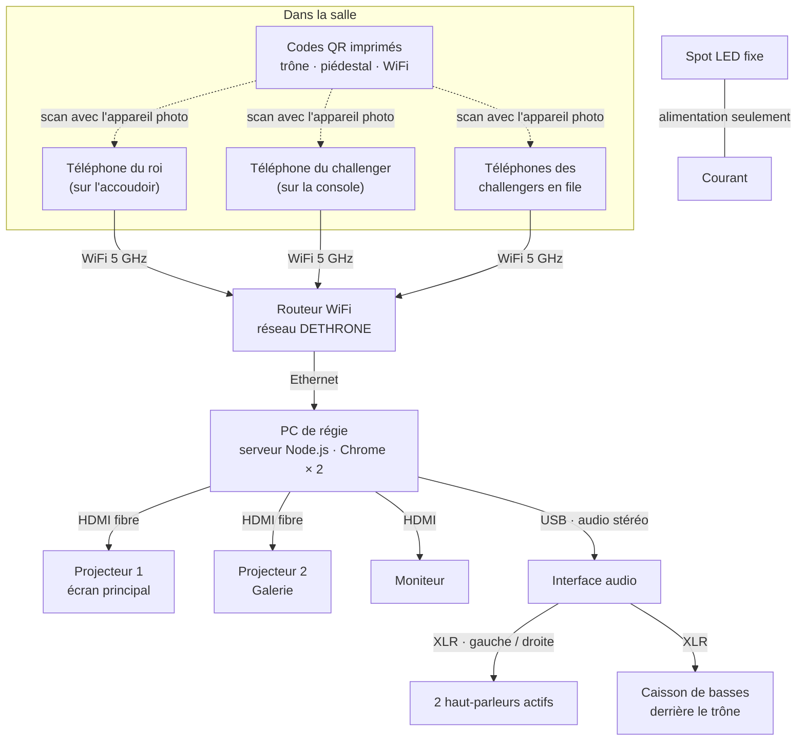
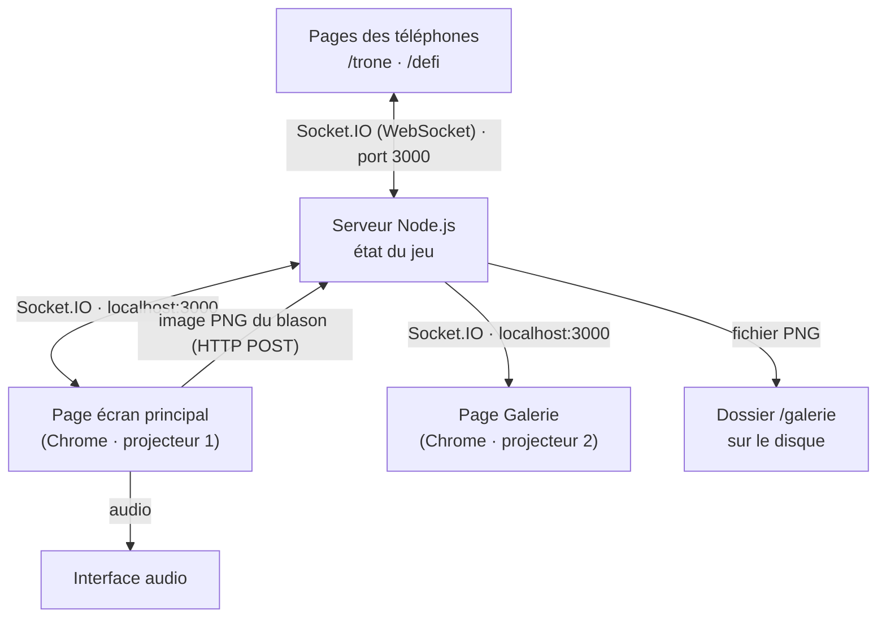
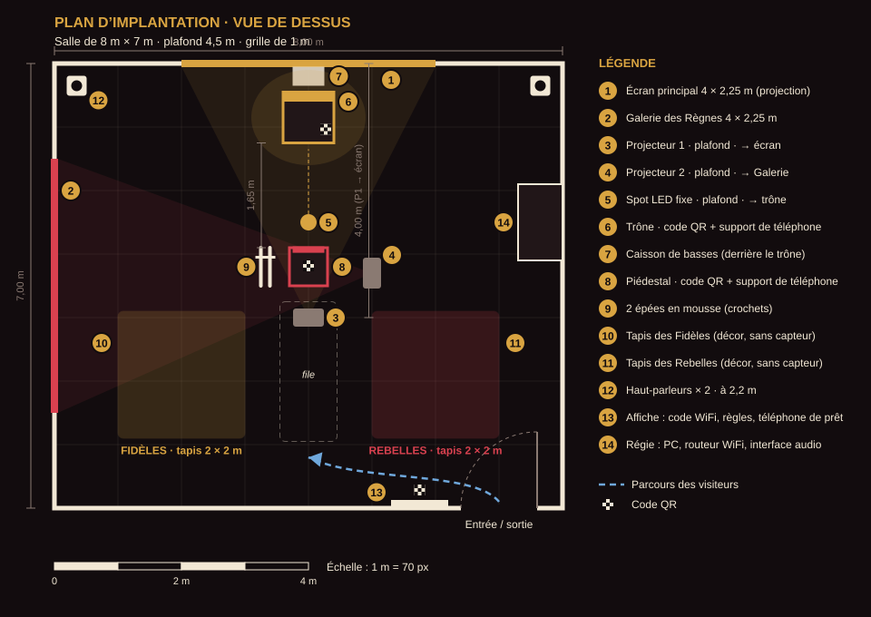
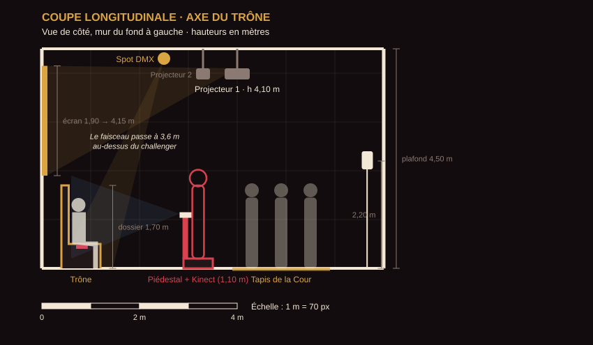

# Technique

## Équipements

Salle de référence : 8 m × 7 m, plafond de 4,5 m, salle sombre (voir la section Plans plus bas).

L'installation n'utilise **aucun capteur** : toutes les interactions passent par les **téléphones** des joueurs (codes QR et page web) et par les **épées en mousse**, qui sont des accessoires de jeu.

### Projection

| Qté | Équipement | Justification |
| --: | -- | -- |
| 2 | Projecteur 4 000 lumens, WUXGA (1920 × 1200), objectif zoom 1,0–1,6 | Un pour l'**écran principal** (derrière le trône), un pour la **Galerie des Règnes** (mur de gauche). 4 000 lm suffisent dans une salle sombre. Le zoom permet de faire une image de 4 m de large à 4 m (P1) et à 5 m (P2). |
| 2 | Support de plafond | Les projecteurs sont suspendus à 4,1 m pour que le faisceau passe au-dessus des duellistes (voir la coupe). |
| 2 | Toile de projection tendue 4 × 2,25 m | Surface uniforme pour l'écran principal et la Galerie (format 16:9). |

### Ordinateur

| Qté | Équipement | Justification |
| --: | -- | -- |
| 1 | PC de régie : Core i5, RTX 3050, 16 Go de RAM, 3 sorties vidéo | Fait tourner le **serveur du jeu** (Node.js) et deux fenêtres Chrome plein écran (écran principal et Galerie). 2 sorties pour les projecteurs et 1 pour le moniteur. |
| 1 | Moniteur de contrôle 24 po | Surveiller le serveur et les deux pages depuis la régie. |

### Réseau et téléphones

| Qté | Équipement | Justification |
| --: | -- | -- |
| 1 | Routeur WiFi 6 bi-bande | Crée le réseau local **DETHRONE**. Les téléphones des joueurs s'y connectent pour ouvrir la page du jeu. Un réseau fermé évite de dépendre d'Internet ou du WiFi du lieu. |
| — | Téléphones des visiteurs | Le roi et les challengers utilisent **leur propre téléphone** : aucune application à installer, seulement une page web. |
| 1 | Téléphone Android de prêt | Pour les visiteurs qui n'ont pas de téléphone ou plus de batterie. |
| 2 | Support de téléphone | Un sur l'accoudoir du trône, un sur la console du piédestal : pendant le duel, le joueur pose son téléphone pour garder les mains libres et voir le geste de la manche. |

### Son

| Qté | Équipement | Justification |
| --: | -- | -- |
| 1 | Interface audio USB 2 sorties | Sortie stéréo propre vers les haut-parleurs. |
| 2 | Haut-parleur actif 8 po | Dans les coins du fond, à 2,2 m : ambiance de grande salle, tambours du duel, clameur. |
| 2 | Pied ou support mural | Fixer les haut-parleurs à 2,2 m, hors de portée du public. |
| 1 | Caisson de basses actif 10 po | Placé juste derrière le trône : le roi **sent** les tambours et les impacts dans son dos. |

### Éclairage

| Qté | Équipement | Justification |
| --: | -- | -- |
| 1 | Projecteur LED blanc chaud 50 W, fixe | Le **spot** au-dessus du trône : il isole le roi. Il reste toujours allumé, sans contrôle informatique, pour garder l'installation simple. |

### Accessoires et décor

| Qté | Équipement | Justification |
| --: | -- | -- |
| 3 | Épée en mousse (type grandeur nature, GN) | Une pour le roi, une pour le challenger, une de rechange. La mousse permet de se toucher sans se blesser. |
| 1 | Crochets muraux | Ranger les épées à côté du piédestal entre les duels. |
| 1 | Trône (MDF, peinture dorée, rembourrage) | L'**objet central** de l'installation. Une plaque dorée sur l'accoudoir porte le code QR du trône. |
| 1 | Piédestal 60 × 60 cm, 20 cm de haut, avec console à 1,1 m | Le challenger se tient dessus. La console porte le code QR du défi et un support de téléphone. |
| 2 | Tapis 2 × 2 m (un doré, un rouge) | Les tapis des **Fidèles** et des **Rebelles**. Ce sont de simples tapis, **sans capteur et sans effet sur le jeu** : ils rassemblent la foule par camp. |
| 1 | Plaques des codes QR et affiche d'accueil | 2 plaques (trône et piédestal) et une affiche à l'entrée avec le code QR du WiFi, les règles du duel et la règle de priorité au plus âgé. |

### Câbles

| Qté | Câble | De → vers |
| --: | -- | -- |
| 2 | HDMI actif fibre 15 m | PC → projecteurs 1 et 2 |
| 3 | XLR 15 m | Interface audio → 2 haut-parleurs et caisson de basses |
| 1 | Ethernet Cat6 2 m | PC → routeur WiFi |
| 5 | Rallonges et barres d'alimentation | Projecteurs, haut-parleurs, caisson, spot, régie |
| 1 | Ruban de sol et passe-câbles | Tous les câbles au sol sont couverts pour la sécurité du public |

## Logiciels

| Rôle | Logiciel | Utilisation dans Dethrône |
| -- | -- | -- |
| Serveur et logique du jeu | **Node.js** + **Express** + **Socket.IO** | Garde l'état du jeu (roi, victoires de suite, file, duel en cours), reçoit les choix des téléphones et envoie les mises à jour à toutes les pages en temps réel |
| Page du téléphone | **HTML, CSS, JavaScript** | Pseudo, file d'attente, choix des 3 gestes, geste de la manche, résultat, blason à enregistrer |
| Écran principal et Galerie | **HTML, JavaScript** + **p5.js** | Animations de l'écran, décomptes du duel, construction du blason génératif, défilement de la Galerie |
| Gestion du son | **Howler.js** (dans la page de l'écran principal) | Ambiances, tambours, impacts, fanfares |
| Logiciel de projection | **Google Chrome** en mode kiosque | Une fenêtre plein écran par projecteur, lancée automatiquement au démarrage |
| Codes QR | Générateur de codes QR (ex. bibliothèque `qrcode`) | Codes du trône, du piédestal et du WiFi |
| Environnement de programmation | **Visual Studio Code** | Écriture et test du code |
| Production sonore | **Reaper** | Création des ambiances et des sons du duel |
| Production visuelle | **Illustrator**, **Photoshop** | Couronnes, icônes des gestes, éléments du blason, interface du téléphone |

## Synoptique

### Câblage et signaux

### Communication entre les logiciels

### Protocoles et signaux

| Liaison | Type de signal | Protocole | Détail |
| -- | -- | -- | -- |
| Code QR → téléphone | Image imprimée | **QR code** | Le code du WiFi connecte le téléphone au réseau ; les codes du trône et du piédestal ouvrent `http://192.168.0.10:3000/trone` ou `/defi` |
| Téléphones → routeur | Sans fil | **WiFi** 5 GHz (WPA2) | Réseau local fermé **DETHRONE** |
| Routeur → PC | Réseau | **Ethernet** | Le PC a une adresse fixe |
| Téléphones ↔ serveur | Réseau | **HTTP** puis **WebSocket (Socket.IO)** | La page est chargée en HTTP, puis les évènements circulent en temps réel |
| Serveur ↔ écran et Galerie | Réseau local (même PC) | **Socket.IO** | Les deux pages reçoivent l'état du jeu |
| Écran → serveur | Réseau local | **HTTP POST** | Le blason dessiné par p5.js est envoyé en PNG et sauvegardé |
| PC → projecteurs | Vidéo | **HDMI** | 1920 × 1200, 60 Hz |
| PC → haut-parleurs | Audio | **USB audio**, puis analogique **XLR** | Stéréo + caisson de basses |

### Évènements Socket.IO

| Évènement | Données | Source → destination |
| -- | -- | -- |
| `rejoindre` | rôle (`trone` ou `defi`), pseudo | Téléphone → serveur |
| `gestes` | les 3 gestes, par exemple `["Feinte", "Attaque", "Parade"]` | Téléphone → serveur |
| `decret` | geste interdit | Téléphone du roi → serveur |
| `quitter` | — | Téléphone du roi → serveur |
| `etat` | roi, victoires de suite, durée du règne, file d'attente | Serveur → toutes les pages |
| `preparer` | geste interdit (s'il y a un décret), durée du décompte | Serveur → téléphones des duellistes et écran |
| `manche` | numéro, geste à faire, puis résultat | Serveur → téléphones et écran |
| `verdict` | gagnant, score | Serveur → téléphones et écran |
| `blason` | adresse de l'image PNG | Serveur → téléphone de l'ex-roi et Galerie |

### Plan d'adressage

| Appareil | Adresse IP | Port |
| -- | -- | -- |
| Routeur WiFi | `192.168.0.1` | — |
| PC de régie | `192.168.0.10` (réservée dans le routeur) | Serveur web et Socket.IO : `3000` |
| Téléphones | attribuées automatiquement (DHCP) | — |

## Plans

<!--
Plans d'implantation 2D et 3D
-->

Les plans sont **à l'échelle** (1 m = 70 px, grille de 1 m). La salle de référence mesure 8 m × 7 m avec un plafond de 4,5 m.

### Plan d'implantation (vue de dessus)

### Coupe (vue de côté)

### Choix d'implantation

- **Le trône au fond, au centre**, face à l'entrée : c'est la première chose qu'on voit en entrant. L'écran principal est juste au-dessus (de 1,9 m à 4,15 m), pour que le roi et son nom soient vus ensemble.
- **Le piédestal à 1,65 m du trône**, face à lui : assez près pour un vrai face-à-face, assez loin pour que les épées en mousse ne touchent pas l'écran ni le trône.
- **Les projecteurs au plafond à 4,1 m** : le faisceau du projecteur 1 passe à environ 3,6 m au-dessus du piédestal, donc même une épée levée ne fait pas d'ombre sur l'écran.
- **Les tapis de chaque côté du piédestal** (2 × 2 m chacun) : la foule entoure le duel, chaque camp de son côté.
- **La file des challengers dans l'allée centrale**, derrière le piédestal ; les épées sont accrochées juste à côté.
- **Les haut-parleurs dans les coins du fond** et **le caisson de basses derrière le trône** : le son vient du trône, comme si le pouvoir parlait.
- **L'affiche d'accueil à l'entrée** : on se connecte au WiFi et on lit les règles avant d'entrer.
- **La régie dans un meuble fermé sur le mur de droite**, hors du parcours des visiteurs. Le routeur WiFi est posé sur le dessus du meuble : sa portée couvre facilement toute la salle de 8 m × 7 m.
- **Parcours** : on entre en bas à droite, on scanne le code WiFi, on remonte l'allée vers le trône, on se place sur un tapis ou dans la file, et on ressort par la même porte.

## Budget

Estimation en dollars canadiens, taxes non incluses. Les prix sont indicatifs et à mettre à jour avec des soumissions.

### Matériel

| Catégorie | Élément | Qté | Prix unitaire | Total |
| -- | -- | --: | --: | --: |
| Projection | Projecteur 4 000 lumens, WUXGA, objectif zoom 1,0–1,6 | 2 | 1 800 $ | 3 600 $ |
| Projection | Support de plafond pour projecteur | 2 | 90 $ | 180 $ |
| Projection | Toile de projection tendue 4 × 2,25 m | 2 | 350 $ | 700 $ |
| Ordinateur | PC de régie (Core i5, RTX 3050, 16 Go RAM, 3 sorties vidéo) | 1 | 1 300 $ | 1 300 $ |
| Ordinateur | Moniteur de contrôle 24 po | 1 | 200 $ | 200 $ |
| Réseau | Routeur WiFi 6 bi-bande | 1 | 150 $ | 150 $ |
| Téléphones | Téléphone Android de prêt (visiteurs sans téléphone) | 1 | 200 $ | 200 $ |
| Téléphones | Support de téléphone (accoudoir et console) | 2 | 25 $ | 50 $ |
| Son | Interface audio USB 2 sorties | 1 | 180 $ | 180 $ |
| Son | Haut-parleur actif 8 po | 2 | 350 $ | 700 $ |
| Son | Pied ou support mural de haut-parleur | 2 | 40 $ | 80 $ |
| Son | Caisson de basses actif 10 po | 1 | 400 $ | 400 $ |
| Éclairage | Projecteur LED blanc chaud 50 W avec pince de plafond | 1 | 150 $ | 150 $ |
| Accessoires | Épée en mousse (type GN), dont 1 de rechange | 3 | 60 $ | 180 $ |
| Accessoires | Crochets muraux pour les épées | 1 | 20 $ | 20 $ |
| Décor | Trône (fabrication MDF, peinture, rembourrage) | 1 | 450 $ | 450 $ |
| Décor | Piédestal avec console à 1,1 m (fabrication) | 1 | 150 $ | 150 $ |
| Décor | Tapis 2 × 2 m (un doré, un rouge) | 2 | 120 $ | 240 $ |
| Impression | Plaques des codes QR et affiche d'accueil | 1 | 60 $ | 60 $ |
| Câbles | HDMI actif fibre 15 m | 2 | 70 $ | 140 $ |
| Câbles | XLR 15 m | 3 | 30 $ | 90 $ |
| Câbles | Ethernet Cat6 2 m (PC → routeur) | 1 | 10 $ | 10 $ |
| Câbles | Rallonges électriques et barres d'alimentation | 5 | 25 $ | 125 $ |
| Câbles | Ruban de sol et passe-câbles | 1 | 80 $ | 80 $ |
| | **Sous-total matériel** | | | **9 435 $** |

### Logiciels

| Logiciel | Coût |
| -- | --: |
| Node.js, Express, Socket.IO | 0 $ |
| p5.js, Howler.js | 0 $ |
| Google Chrome (mode kiosque) | 0 $ |
| Visual Studio Code | 0 $ |
| Reaper (licence réduite) | 85 $ |
| Suite Adobe (licence du collège) | 0 $ |
| **Sous-total logiciels** | **85 $** |

### Développement

| Tâche | Heures | Taux horaire | Total |
| -- | --: | --: | --: |
| Programmation (serveur, pages téléphone, écran et Galerie) | 70 h | 25 $ | 1 750 $ |
| Production visuelle et sonore | 30 h | 25 $ | 750 $ |
| Fabrication et montage | 25 h | 25 $ | 625 $ |
| **Sous-total développement** | | | **3 125 $** |

### Maintenance (pour un mois d'exposition)

| Élément | Qté | Prix unitaire | Total |
| -- | --: | --: | --: |
| Épée en mousse de remplacement | 2 | 60 $ | 120 $ |
| Pile et câble de recharge pour le téléphone de prêt | 1 | 30 $ | 30 $ |
| **Sous-total maintenance** | | | **150 $** |

### Total

| Poste | Montant |
| -- | --: |
| Matériel | 9 435 $ |
| Logiciels | 85 $ |
| Développement | 3 125 $ |
| Maintenance | 150 $ |
| Imprévus (10 %) | 1 280 $ |
| **Total estimé** | **14 075 $** |
